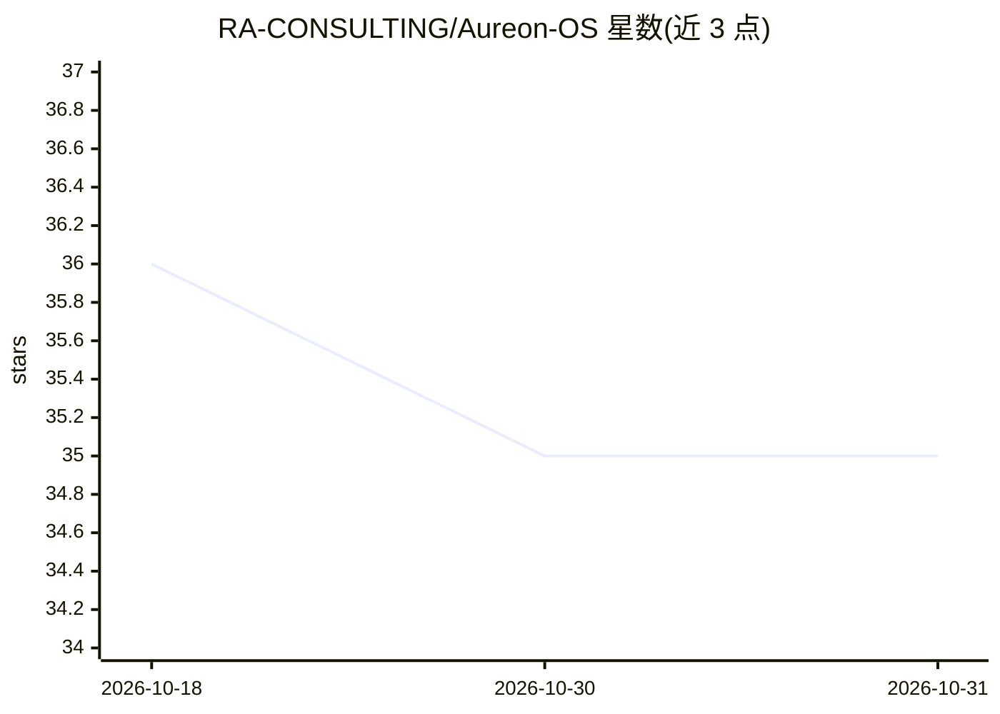

# RA-CONSULTING/Aureon-OS

⭐ 35 · Python · MIT · 推送 2026-10-30 · [GitHub](https://github.com/RA-CONSULTING/Aureon-OS) · [官网](https://aureonzorzatechnologies.pl) · 组织维护

**本地优先的可审计 AI 操作层：多模型路由、自主运维与交易研究一体化**

由 R&A Consulting（Aureon Zorza Technologies）开发的本地优先操作层：统一控制台下包含多模型路由并加'良心否决'的 AI Operator、带工具调用与硬权限边界的 agent 认知层、约 1,100 模块的 SaaS 目录、React 统一界面与自我编码的 organism。支持 Kraken/Binance/Alpaca/Capital.com 四个交易所的 paper/live 交易模式。关键限制：发布边界为 HOLD，受支持的运行时（容器、supervisor、多用户）均处于 HOLD 状态，当前仅支持源码检视与离线测试；无完整交易所密钥时保持 paper/public-data 模式。通过安装脚本或 organism 启动脚本运行，Python 3.11+，MIT 许可。

## 筛选速览

| 维度 | 判定 | 备注 |
|---|---|---|
| AI 角色 | `ai-native` | 本体是模型或模型工具 |
| 许可风险 | `permissive` | MIT |
| 部署形态 | `library` | 以包/库形式分发 |
| 模型依赖 | — | README 未给出锁定关系 |
| 硬件要求 | — | 无带数字的原话,不猜 |
| 安装摩擦 | `low` | 无编译、无系统依赖或容器化 |
| 成熟度 | `idea` | |

## 能力要点

- 多模型路由 + 共识 + 良心否决的回答管线（aureon/operator）
- 硬权限边界：任何后果性动作需通过权限边界与 conscience veto
- 自主模式默认 full：自编码可修改除凭证外任意路径，动作记录至 autonomy_audit.jsonl
- 交易所密钥缺席时自动降级为 paper/public-data 模式

## 适用场景

- 在一个本地系统里检视与运行交易研究、自主 operator 与编码 organism
- 以审计视角追踪自主系统的每次动作与自补丁记录
- 在 paper 模式下先验证系统行为再决定是否注入交易所密钥

## 场景标签

`模型网关` `金融量化` `Agent 框架` · 领域:Agent 开发

## 证据(README 行号)

> L18: Aureon OS is a **local-first operating layer** — powered by the Harmonic Nexus Core — that
> L51: |**Aureon Operator**|A grounded AI switchboard — routes a prompt through many models, grounds it in the repo, reach

## 星数曲线

2026-10-18 36 → 2026-10-31 35（-1）

---
*卡片 v1 · prompt 1.4 · 生成 2026-10-25 · 置信度 high · 依据 README sha `5d02f3c7774f` · [字段定义](../../DATASET.md)*
