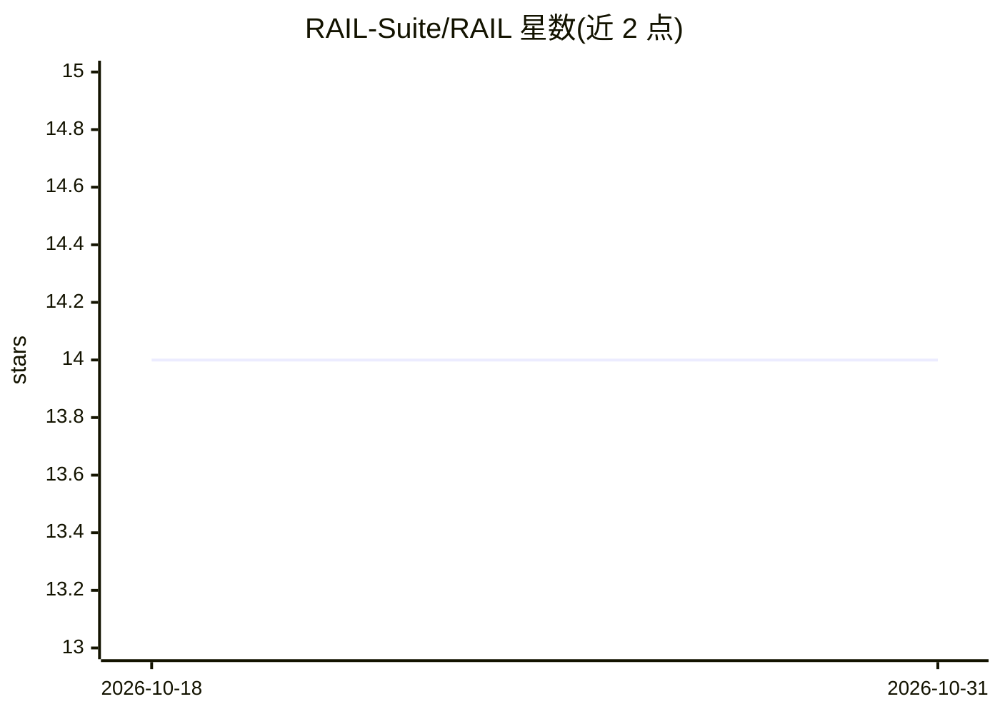

# RAIL-Suite/RAIL

⭐ 14 · C++ · MIT · 推送 2026-01-21 · [GitHub](https://github.com/RAIL-Suite/RAIL) · 组织维护

**让任意应用经一行代码接入 LLM 的通用桥接协议与 SDK 套件**

RAIL（Remote Agent Invocation Layer）提供一套由多个子项目组成的桥接体系：WPF 主应用 RailOrchestrator 连接 GPT/Claude/Gemini 并以 ReAct agent 循环路由工具调用，通过 Named Pipe 与 Native AOT 编译的 RailBridge.Native DLL 实现跨语言 IPC；C#/.NET、C++（RTTR 反射或自定义 dispatcher 两种模式）、Python（ctypes）、Node.js（ffi-napi，README 标注 Never tested）各有客户端 SDK。面向希望在不重写代码的前提下让现有或遗留应用可被 AI 自然语言调用的开发者；RailStudio 提供扫描与 rail.manifest.json 生成。Node.js SDK 未经测试为已声明限制。

## 筛选速览

| 维度 | 判定 | 备注 |
|---|---|---|
| AI 角色 | `ai-ecosystem` | LLM/agent 周边工具 |
| 许可风险 | `permissive` | MIT |
| 部署形态 | `desktop` | 安装包/桌面程序 |
| 模型依赖 | locked-api |  |
| 硬件要求 | — | 无带数字的原话,不猜 |
| 安装摩擦 | `medium` | 含编译或系统依赖之一 |
| 成熟度 | — | 结构信号不足 |

## 能力要点

- 一行代码（Ignite()）将应用方法暴露给 LLM 调用
- C#/C++/Python/Node.js 多语言 SDK，Named Pipe + Native AOT 跨语言桥
- ReAct agent 循环与多 LLM 路由（Gemini/OpenAI/Anthropic/Claude）
- RailStudio 可视化扫描 EXE/DLL 并自动生成 rail.manifest.json

## 适用场景

- 让遗留 C++ 程序（如 Notepad++、Doom 这类无 RTTR 代码库）可被 AI 调用
- 通过自然语言指挥已有 .NET/Python 应用的业务方法执行
- 在不重写应用的前提下为内部工具加 AI 控制接口

## 场景标签

`Agent 框架` · 领域:Agent 开发

## 证据(README 行号)

> L7: RAIL is a **universal bridge** that connects any application (C#, C++, Python, Node.js) to any LLM (GPT, Claude, Gem
> L30: - ReAct agent loop for multi-step reasoning

## 星数曲线

2026-10-18 14 → 2026-10-31 14（+0）

---
*卡片 v1 · prompt 1.4 · 生成 2026-10-31 · 置信度 high · 依据 README sha `29ea5b840588` · [字段定义](../../DATASET.md)*
