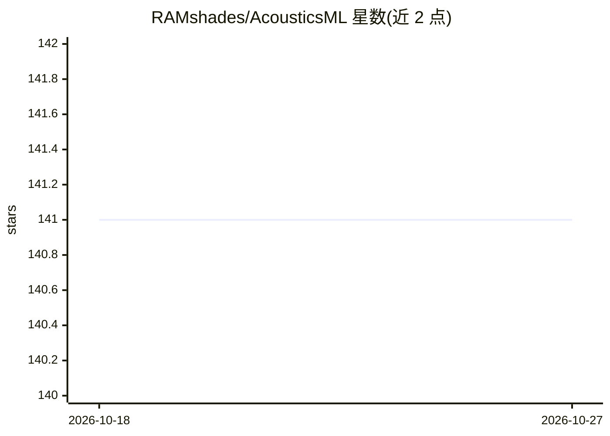

# RAMshades/AcousticsML

⭐ 141 · Jupyter Notebook · 推送 2026-04-17 · [GitHub](https://github.com/RAMshades/AcousticsML) · 组织维护

**声学机器学习教程仓库：覆盖信号处理到深度学习的示例 notebooks**

由 McCarthy 等五位作者维护的声学机器学习教程与开源代码仓库，配套论文发表于 npj Acoustics（2025）。以 Jupyter notebook 形式组织六章内容：声学信号处理、特征提取与选择、无监督方法（PCA/字典学习/自编码器）、监督方法（回归/决策树/随机森林）、深度学习（CNN/GAN/隐式神经表示/物理信息神经网络）与可解释 AI。示例来自海洋声学、房间声学（RIR 生成）与个性化空间音频（HRTF 上采样）。通过 conda 环境文件或手动 conda 安装依赖运行，部分数据集需 Kaggle API 凭证下载。

## 筛选速览

| 维度 | 判定 | 备注 |
|---|---|---|
| AI 角色 | `ai-knowledge` | 知识聚合/清单类 |
| 许可风险 | `none` | — |
| 部署形态 | `library` | 以包/库形式分发 |
| 模型依赖 | — | README 未给出锁定关系 |
| 硬件要求 | — | 无带数字的原话,不猜 |
| 安装摩擦 | `low` | 无编译、无系统依赖或容器化 |
| 成熟度 | — | 结构信号不足 |

## 能力要点

- 六章 notebook 覆盖监督、无监督与深度学习方法
- 示例应用含房间脉冲响应生成、HRTF 表示与波动方程求解
- 物理信息神经网络（正/逆问题）示例
- 配套综述论文发表于 npj Acoustics 并提供引用格式

## 适用场景

- 学习声学领域的机器学习方法与代码实现
- 了解 RIR 生成、HRTF 表示等声学任务的建模方式
- 作为声学 ML 科研入门的代码参考

## 场景标签

`教程课程` · 领域:学习与行业

## 证据(README 行号)

> L4: # Tutorial: Machine Learning for Acoustics
> L7: Acoustic data provide scientific and engineering insights in fields ranging from biology and communications to ocean
> L110: To learn more, please find our paper in npj acoustics here, on arxiv here, or on Github here. To cite this work, p

## 星数曲线

2026-10-18 141 → 2026-10-27 141（+0）

---
*卡片 v1 · prompt 1.4 · 生成 2026-10-22 · 置信度 mid · 依据 README sha `a41096a96966` · [字段定义](../../DATASET.md)*
