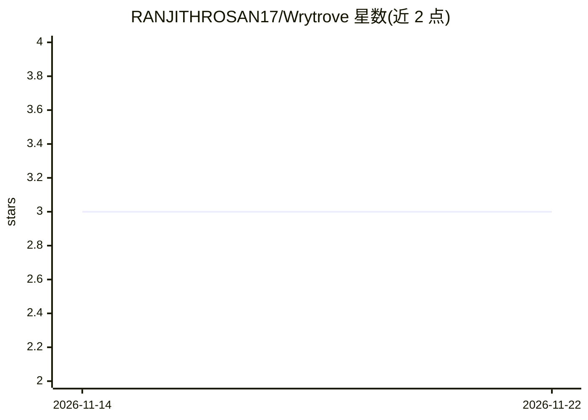

# RANJITHROSAN17/Wrytrove

⭐ 3 · TypeScript · MIT · 推送 2026-11-19 · [GitHub](https://github.com/RANJITHROSAN17/Wrytrove) · [官网](https://ranjithrosan17.github.io/Wrytrove/) · 个人维护

**面向 Windows 用户的开源文本与代码编辑器，AI 建议可选**

基于 Tauri 与 TypeScript 构建的 Windows x64 文本/代码编辑器，覆盖标签页、查找替换、语法高亮、Markdown 预览、多文件夹工作区、wiki 链接笔记层、会话恢复等编辑器功能。AI 部分为可选：本地 Ollama 行内建议（发送至 127.0.0.1:11434）、选区上的可审查 AI 操作（改进/修复/缩短/总结等，应用前展示 diff），以及浏览器 Arena 工作流和可选 API 面板。提供签名或未签名预览安装包，也可从源码构建；自称早期预览版，非 IDE。

## 筛选速览

| 维度 | 判定 | 备注 |
|---|---|---|
| AI 角色 | `ai-enhanced` | 去掉 AI 部分产品仍成立 |
| 许可风险 | `permissive` | MIT |
| 部署形态 | `desktop` | 安装包/桌面程序 |
| 模型依赖 | local-ok | 支持本地模型 |
| 硬件要求 | — | 无带数字的原话,不猜 |
| 安装摩擦 | `low` | 无编译、无系统依赖或容器化 |
| 成熟度 | `idea` | |

## 能力要点

- 可选本地 Ollama 行内 AI 建议，默认关闭、需显式启用
- 选区 AI 操作在应用前展示 diff 并需明确接受
- 语法高亮、Markdown 预览、wiki 链接与每日笔记等编辑/笔记功能
- 提供安装包下载、源码构建与浏览器 UI 预览三种运行方式

## 适用场景

- 日常记笔记并顺带处理快速编程任务
- 在本地编辑器中获得可选的行内 AI 补全
- 本地整理带标签和双链的 Markdown 笔记

## 场景标签

`代码生成` `知识库管理` `AI 写作` · 领域:编码与开发

## 证据(README 行号)

> L15: Wrytrove is a Windows text and code editor designed to be approachable for everyday notes and useful for quick prog
> L45: - **AI on your terms:** optional inline suggestions, **reviewable AI actions on a selection** (improve, fix, shorte
> L108: - **Ollama:** inline suggestions start off each time. If you explicitly enable them in the desktop app, nearby edi

## 星数曲线

2026-11-14 3 → 2026-11-22 3（+0）

---
*卡片 v1 · prompt 1.4 · 生成 2026-11-22 · 置信度 high · 依据 README sha `3c48555b6719` · [字段定义](../../DATASET.md)*
