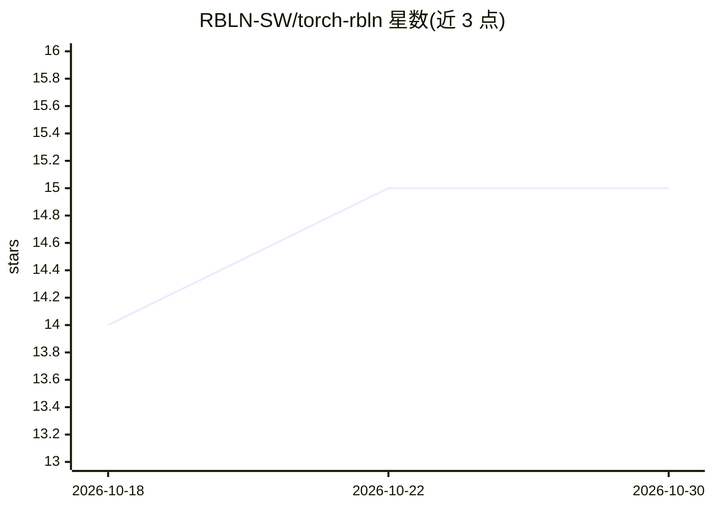

# RBLN-SW/torch-rbln

⭐ 15 · Python · Apache-2.0 · 推送 2026-10-29 · [GitHub](https://github.com/RBLN-SW/torch-rbln) · 组织维护

**让 PyTorch 在 Rebellions NPU 上运行的 PyTorch 扩展**

面向 Rebellions NPU 的 PyTorch out-of-tree 扩展：提供 rbln 设备、torch.rbln API 与 torch.compile 支持，以 define-by-run 的 eager 模式运行，覆盖模型开发、部署与 serving 全流程，操作执行由 RBLN 编译器与运行时 rebel-compiler 协调。给需要在 Rebellions NPU 上开发/部署 PyTorch 模型的开发者使用。限制：处于 beta，API 可能变动，不保证向后兼容，不建议生产使用；rebel-compiler 需通过 RBLN Portal 账号从专有包索引安装。

## 筛选速览

| 维度 | 判定 | 备注 |
|---|---|---|
| AI 角色 | `ai-ecosystem` | LLM/agent 周边工具 |
| 许可风险 | `permissive` | Apache-2.0 |
| 部署形态 | `library` | 以包/库形式分发 |
| 模型依赖 | — | README 未给出锁定关系 |
| 硬件要求 | — | 无带数字的原话,不猜 |
| 安装摩擦 | `low` | 无编译、无系统依赖或容器化 |
| 成熟度 | `idea` | |

## 能力要点

- 提供 rbln 设备、torch.rbln 与 torch.compile 接口，风格与 CPU/GPU 一致
- eager 模式（define-by-run），支持调试与模型开发/部署/serving 生命周期
- 经 PyTorch out-of-tree 扩展路径集成，执行由 rebel-compiler 编译器与运行时协调
- 文档包含 Llama3.2-1B 的 transformers 运行示例与算子覆盖清单

## 适用场景

- 在 Rebellions NPU 上开发与调试 PyTorch 模型
- 将现有 CPU/GPU PyTorch 代码迁移到 rbln 设备运行
- 在 NPU 上部署与 serving 大语言模型（如 Llama3.2-1B）

## 场景标签

`推理引擎` · 领域:训练与推理

## 证据(README 行号)

> L12: PyTorch RBLN (`torch-rbln`) is a PyTorch extension that allows natural use of Rebellions NPU compute within PyTorch
> L14: The same interface style as **CPU** and **GPU** applies — the **`rbln`** device, **`torch.rbln`**, and **`torch.com

## 星数曲线

2026-10-18 14 → 2026-10-30 15（+1）

---
*卡片 v1 · prompt 1.4 · 生成 2026-10-30 · 置信度 high · 依据 README sha `5e103a6c3b9e` · [字段定义](../../DATASET.md)*
