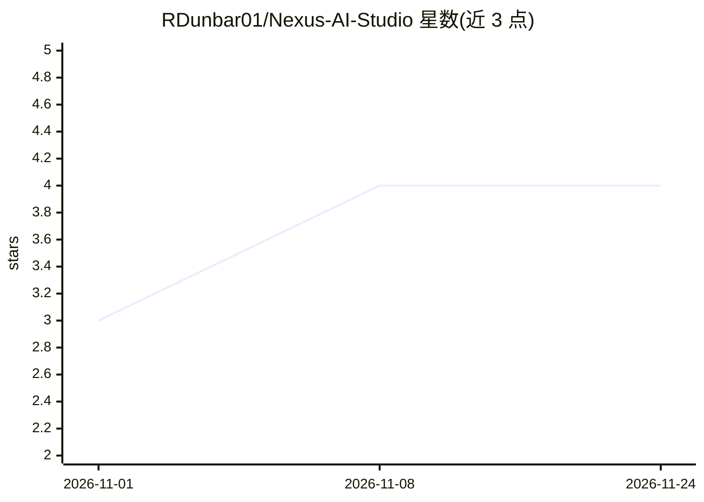

# RDunbar01/Nexus-AI-Studio

⭐ — · [GitHub]() · 个人维护

**本地运行 GGUF 模型的浏览器 AI 工作区**

一个可在浏览器中运行的本地 AI 工作区，通过自研 WebGPU 推理引擎加载本地 GGUF 模型进行聊天，不使用本地服务器、不上传模型数据、无 CPU 回退。完整桌面应用额外提供原生 Nexus.cpp 推理路径、硬件配置档案、前缀缓存、诊断日志等，且原生可执行文件需另行构建。浏览器试用版为单个 HTML 文件，嵌入界面、推理代码与分词器模板库，不内置任何模型。

## 筛选速览

| 维度 | 判定 | 备注 |
|---|---|---|
| AI 角色 | `ai-native` | 本体是模型或模型工具 |
| 许可风险 | `none` | — |
| 部署形态 | `None` |  |
| 模型依赖 | — | README 未给出锁定关系 |
| 硬件要求 | — | 无带数字的原话,不猜 |
| 安装摩擦 | `low` | 无编译、无系统依赖或容器化 |
| 成熟度 | — | 结构信号不足 |

## 能力要点

- 单 HTML 文件浏览器试用版，无需 Python/安装器/构建步骤
- 加载器校验模型架构、张量、量化与分词器兼容性
- 自研 WebGPU 与 Nexus.cpp 双推理路径，非 PyTorch 后端
- 原生协议 3 支持会话级前缀缓存与 min-p/重复惩罚控制

## 适用场景

- 在浏览器中加载本地 GGUF 模型进行离线聊天
- 在无 Python 环境的机器上评估本地推理流程
- 使用 Radeon 显卡配置档案进行本地推理实验

## 场景标签

`AI 助手` `推理引擎` · 领域:对话与助手

## 证据(README 行号)

> L5: A local AI workspace for importing supported language models and running chat through the custom WebGPU or Nexus.cpp
> L11: Open the trial, choose your GPU profile and memory capacity in Models & settings, then select a local GGUF model an

## 星数曲线

2026-11-01 3 → 2026-11-24 4（+1）

---
*卡片 v1 · prompt 1.4 · 生成 2026-11-21 · 置信度 high · 依据 README sha `477a24a1cf21` · [字段定义](../../DATASET.md)*
