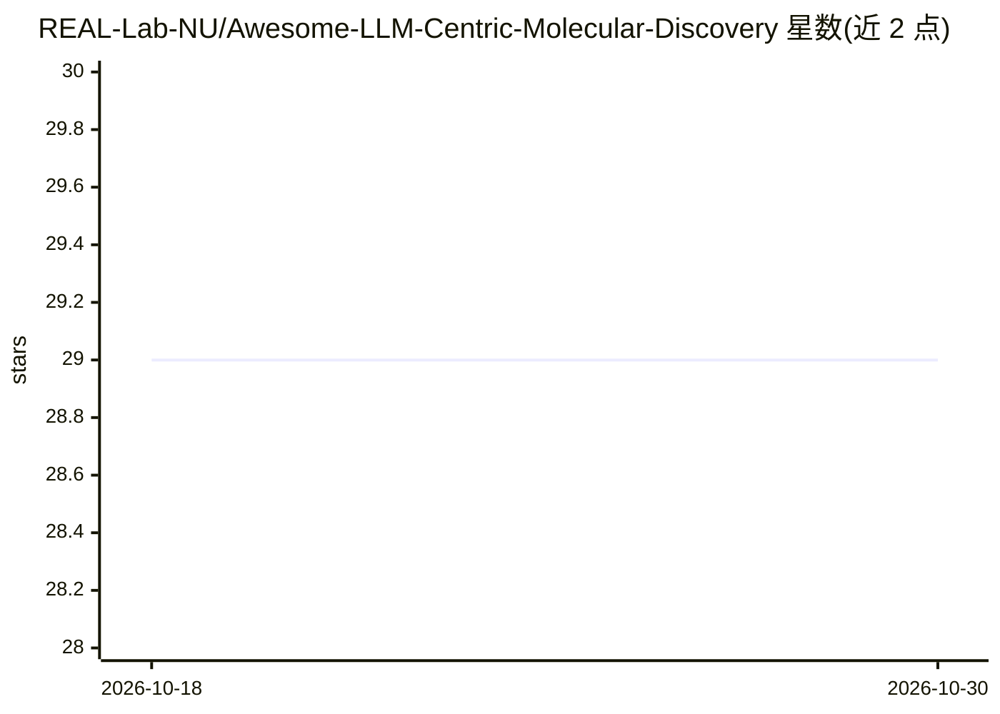

# REAL-Lab-NU/Awesome-LLM-Centric-Molecular-Discovery

⭐ 29 · 推送 2026-09-07 · [GitHub](https://github.com/REAL-Lab-NU/Awesome-LLM-Centric-Molecular-Discovery) · 组织维护

**ACL 2026 综述配套的 LLM 分子发现论文阅读清单**

伴随 ACL 2026 综述论文《A Survey of Large Language Models for Text-Guided Molecular Discovery》维护的策展阅读清单：收录文本引导分子生成与优化两类方法（按零样本提示/ICL、SFT、偏好调优分类），条目含发表信息与代码/模型/数据链接；另整理分子数据集（ChEMBL、PubChem、SMolInstruct 等）、四维评估指标（有效性/可合成性/性质控制/多样性）与工具基准。面向药物发现与化学信息学研究者检索文献和资源。

## 筛选速览

| 维度 | 判定 | 备注 |
|---|---|---|
| AI 角色 | `ai-knowledge` | 知识聚合/清单类 |
| 许可风险 | `none` | — |
| 部署形态 | `None` |  |
| 模型依赖 | — | README 未给出锁定关系 |
| 硬件要求 | — | 无带数字的原话,不猜 |
| 安装摩擦 | `low` | 无编译、无系统依赖或容器化 |
| 成熟度 | — | 结构信号不足 |

## 能力要点

- 分子生成与优化两个任务表，按学习范式（ICL/SFT/偏好调优）分类
- 收录 18 个分子数据集并标注规模与用途
- 按有效性/可合成性/性质控制/多样性四维组织评估指标
- 条目附代码、模型、数据集或项目页链接

## 适用场景

- 查找文本引导分子生成/优化的代表性方法与代码
- 为分子建模选择数据集与评估指标
- 综述写作或入门时按分类梳理该方向文献

## 场景标签

`精选清单` · 领域:学习与行业

## 证据(README 行号)

> L3: A curated reading list for text-guided molecule generation and optimization, accompanying our **ACL 2026** survey:
> L17: The survey focuses on foundation-scale LLMs, with at least one billion parameters, that directly generate or edit m

## 星数曲线

2026-10-18 29 → 2026-10-30 29（+0）

---
*卡片 v1 · prompt 1.4 · 生成 2026-10-26 · 置信度 high · 依据 README sha `a80c4051beb0` · [字段定义](../../DATASET.md)*
