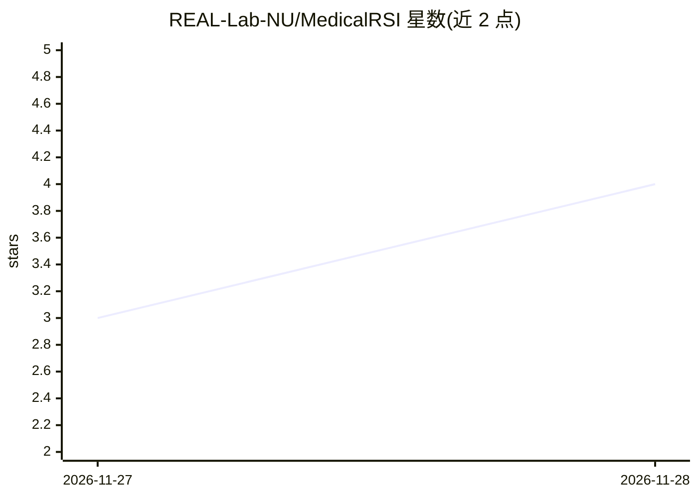

# REAL-Lab-NU/MedicalRSI

⭐ 4 · Python · MIT · 推送 2026-11-23 · [GitHub](https://github.com/REAL-Lab-NU/MedicalRSI) · [官网](https://real-lab-nu.github.io/MedicalRSI/) · 组织维护

**给科研人员的医疗递归自我改进 Agent 训练框架**

一个医学 Agent 研究代码库：同一模型扮演 Solver（执行临床工作流的医疗 Agent）与 Improver（可学习的改进策略）两个角色，通过工作流证据、技能与工具、工作流记忆、反事实增益奖励做联合双角色优化，训练后可在未见工作流上做测试时适配。提供 conda+pip 安装、MedAgentBench FHIR 服务器 Docker 镜像、Hugging Face 已发布模型的一键评测与训练脚本；MIMIC-III 数据需 PhysioNet 凭据访问。

## 筛选速览

| 维度 | 判定 | 备注 |
|---|---|---|
| AI 角色 | `ai-native` | 本体是模型或模型工具 |
| 许可风险 | `permissive` | MIT |
| 部署形态 | `self-host` | docker 或自建部署 |
| 模型依赖 | — | README 未给出锁定关系 |
| 硬件要求 | — | 无带数字的原话,不猜 |
| 安装摩擦 | `low` | 无编译、无系统依赖或容器化 |
| 成熟度 | — | 结构信号不足 |

## 能力要点

- Solver/Improver 双角色联合优化，反事实增益奖励机制
- 测试时适配：从少量失败写出 harness，无需重训
- 发布 Hugging Face 模型，下载即可评测无需训练
- 支持 MedAgentBench（85.1%）与 MedAgentGym（89.0%）评测

## 适用场景

- 在 MedAgentBench/MedAgentGym 上评测医疗 LLM Agent
- 训练能从自身执行结果改进策略的临床 Agent
- 把 harness 迁移给其他 solver 或新临床数据库环境

## 场景标签

`模型评测` `科研工具` `强化学习` · 领域:评测与运维

## 证据(README 行号)

> L24:  Solver: the medical agent itself. Improver: its learnable improving strategy.
> L28:  Overview of MedicalRSI: the Solver attempts a workflow with H0, the attempts become workflow evidence, the Improve
> L63: > The released MedAgentBench model needs no training: download it and run `evaluate`.

## 星数曲线

2026-11-27 3 → 2026-11-28 4（+1）

---
*卡片 v1 · prompt 1.4 · 生成 2026-11-27 · 置信度 high · 依据 README sha `d1bdd19e9839` · [字段定义](../../DATASET.md)*
