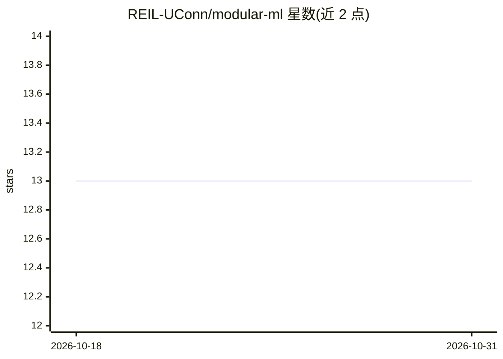

# REIL-UConn/modular-ml

⭐ 13 · Python · Apache-2.0 · 推送 2026-06-11 · [GitHub](https://github.com/REIL-UConn/modular-ml) · [官网](https://modular-ml.readthedocs.io) · 组织维护

**面向科研的模块化可复现 ML 实验框架**

后端无关的机器学习实验框架，供研究场景设计、训练和评估 ML 流水线。核心抽象包括：FeatureSet 数据容器与视图、内置 splitters/samplers（支持分层、分组、三元组等批次策略）、包装 PyTorch/TensorFlow/scikit-learn 模型的后端包装器、以 DAG 组织的 ModelGraph（可混用后端）、绑定损失到节点的 AppliedLoss，以及 Train/Fit/Eval 三类实验阶段。所有主要类实现序列化，可导出为单一 .mml 文件实现复现与共享。需 Python >= 3.10。

## 筛选速览

| 维度 | 判定 | 备注 |
|---|---|---|
| AI 角色 | `ai-ecosystem` | LLM/agent 周边工具 |
| 许可风险 | `permissive` | Apache-2.0 |
| 部署形态 | `library` | 以包/库形式分发 |
| 模型依赖 | — | README 未给出锁定关系 |
| 硬件要求 | — | 无带数字的原话,不猜 |
| 安装摩擦 | `low` | 无编译、无系统依赖或容器化 |
| 成熟度 | — | 结构信号不足 |

## 能力要点

- Torch/TensorFlow/scikit-learn 后端包装器，DAG 中可混用后端
- TrainPhase/FitPhase/EvalPhase 三类实验阶段，实验对象统一编排
- 所有主要类支持序列化，可导出为单一 .mml 文件复现实验
- 内置回调（EarlyStopping、评估等）与断点续训检查点

## 适用场景

- 科研项目中构建可复现的复杂多分支模型实验
- 在统一接口下混用 PyTorch、TensorFlow 与 scikit-learn 组件
- 跨折交叉验证等执行策略下重放同一实验计划

## 场景标签

`科研工具` · 领域:学习与行业

## 证据(README 行号)

> L11: ModularML is a flexible, backend-agnostic machine learning framework for designing, training, and evaluating machin
> L14: > ModularML provides a plug-and-play ecosystem of interoperable components for data preprocessing, sampling, modeli

## 星数曲线

2026-10-18 13 → 2026-10-31 13（+0）

---
*卡片 v1 · prompt 1.4 · 生成 2026-10-31 · 置信度 high · 依据 README sha `39b76e800e3f` · [字段定义](../../DATASET.md)*
