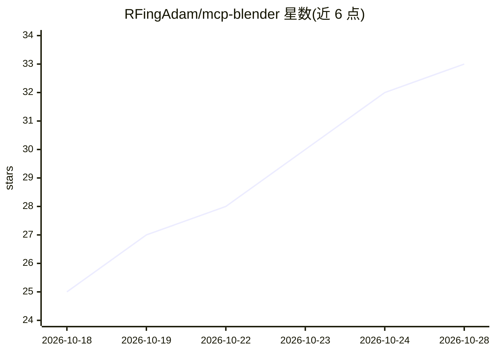

# RFingAdam/mcp-blender

⭐ 33 · Python · AGPL-3.0 · 推送 2026-10-23 · [GitHub](https://github.com/RFingAdam/mcp-blender) · 个人维护

**面向 MCP 客户端的 Blender 工具服务器：218 个 3D 建模与生成工具**

一个 MCP server，通过 stdio 暴露 218 个 Blender 工具给任意 MCP 兼容客户端（Claude Desktop、Claude Code、Codex CLI）；配套 Blender 插件监听本地 TCP 端口（默认 9876），经 bpy.app.timers 在主线程分发调用。工具覆盖建模、材质、雕刻、动画、渲染、烘焙、几何节点、物理，以及 MSFS 2020/2024 内容管线（LOD/碰撞/涂装）与多后端 AI 文本/图生 3D（Hyper3D Rodin、Meshy、Tripo、TripoSR、Hunyuan3D、ComfyUI 等）。内置渲染-分析-修正自迭代回路（Ollama 视觉模型打分）。要求 Python 3.10+ 与 Blender 4.2+，需同时安装 pip 包与 Blender 插件，AGPL-3.0 许可（v0.4.0 从 MIT 变更）。PyPI 上的同名包为无关项目，需从 GitHub 安装。

## 筛选速览

| 维度 | 判定 | 备注 |
|---|---|---|
| AI 角色 | `ai-ecosystem` | LLM/agent 周边工具 |
| 许可风险 | `viral` | AGPL-3.0 |
| 部署形态 | `desktop` | 安装包/桌面程序 |
| 模型依赖 | local-ok | 支持本地模型 |
| 硬件要求 | — | 无带数字的原话,不猜 |
| 安装摩擦 | `low` | 无编译、无系统依赖或容器化 |
| 成熟度 | — | 结构信号不足 |

## 能力要点

- 218 个 MCP 工具覆盖 Blender 全管线（建模/材质/动画/烘焙/几何节点/物理等）
- MSFS 2020/2024 内容管线：LOD 层级、碰撞网格、涂装与多家机型涂装转移
- 多后端 AI 文生/图生 3D（云端 API 与本地模型），附自动网格清理与减面
- 渲染-分析-修正自迭代回路：多角度渲染后由 Ollama 视觉模型打分收敛

## 适用场景

- 在 IDE 或终端里用自然语言让 AI agent 操作 Blender 建模与渲染
- 通过迭代回路让 agent 自动修正几何体直至符合目标描述
- 制作 MSFS 飞机涂装与 LOD/碰撞等模拟飞行内容
- 用文本或图片提示词生成 3D 模型并导入 Blender 场景

## 场景标签

 · 领域:3D 创作/生成式 AI 工具

## 证据(README 行号)

> L22: `mcp-blender` is an MCP server that exposes 218 Blender tools to any
> L24: The MCP server speaks the Model Context Protocol over stdio; a Blender
> L23: MCP-compatible AI client (Claude Desktop, Claude Code, Codex CLI, …).

## 星数曲线

2026-10-18 25 → 2026-10-28 33（+8）

---
*卡片 v1 · prompt 1.4 · 生成 2026-10-26 · 置信度 mid · 依据 README sha `c46452c2b9be` · [字段定义](../../DATASET.md)*
