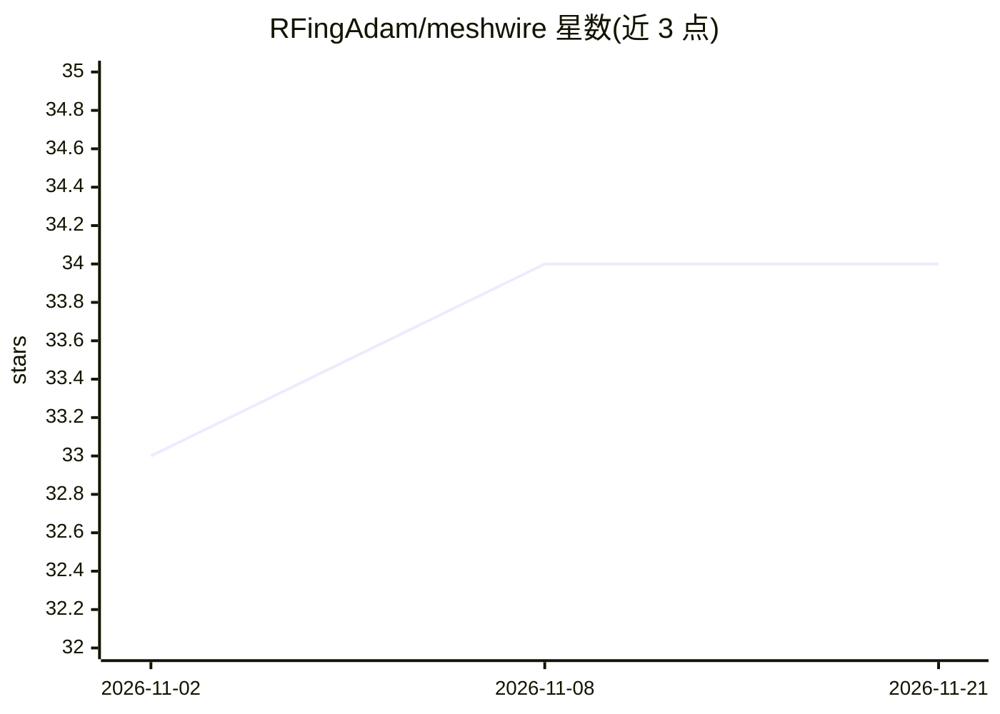

# RFingAdam/meshwire

⭐ 34 · Python · AGPL-3.0 · 推送 2026-11-20 · [GitHub](https://github.com/RFingAdam/meshwire) · 个人维护

**让 MCP 客户端控制 Blender 的 MCP 服务器，含 225 个工具**

面向 Claude Desktop、Claude Code、Codex CLI 等 MCP 客户端的独立 MCP 服务器，经 stdio 通信，由 Blender 插件通过本地 TCP socket 在主线程执行命令。225 个工具覆盖建模、材质、雕刻、动画、渲染、烘焙、几何节点、绑定与物理，含 MSFS 内容工具与文本/图像转 3D（Hyper3D Rodin、Meshy、Tripo、TripoSR、Stable Fast 3D、Hunyuan3D、ComfyUI 后端）。自精炼循环用 Ollama 视觉模型给多角度渲染打分并迭代。socket 握手用 HMAC-SHA256 token，execute_script 默认关闭需手动开启；MSFS 工具输出尚未在模拟器中验证。

## 筛选速览

| 维度 | 判定 | 备注 |
|---|---|---|
| AI 角色 | `ai-ecosystem` | LLM/agent 周边工具 |
| 许可风险 | `viral` | AGPL-3.0 |
| 部署形态 | `desktop` | 安装包/桌面程序 |
| 模型依赖 | local-ok | 支持本地模型 |
| 硬件要求 | — | 无带数字的原话,不猜 |
| 安装摩擦 | `low` | 无编译、无系统依赖或容器化 |
| 成熟度 | — | 结构信号不足 |

## 能力要点

- 225 个工具覆盖建模/材质/动画/渲染/烘焙/几何节点/雕刻/绑定/物理
- 文本与图像转 3D：3 个云端 API key 后端与 4 个本地后端
- 自精炼循环：多角度渲染由 Ollama 视觉模型打分并迭代
- HMAC-SHA256 token 握手与默认关闭的 execute_script 安全机制

## 适用场景

- 用 Claude 等 MCP 客户端通过自然语言在 Blender 中建模与渲染
- 生成 MSFS 飞机涂装与 LOD/碰撞等内容包
- 用本地 3D 生成后端从文本或图片生成模型并导入 Blender

## 场景标签

 · 领域:3D 创作/工具集成

## 证据(README 行号)

> L26: Meshwire is an MCP server for AI clients such as Claude Desktop, Claude Code, and Codex CLI.
> L27: The server speaks the Model Context Protocol over stdio. A Blender addon listens on a local TCP
> L42: - **AI 3D generation:** text and image to 3D through Hyper3D Rodin, Meshy, Tripo, TripoSR,

## 星数曲线

2026-11-02 33 → 2026-11-21 34（+1）

---
*卡片 v1 · prompt 1.4 · 生成 2026-11-18 · 置信度 high · 依据 README sha `00e65a17bded` · [字段定义](../../DATASET.md)*
