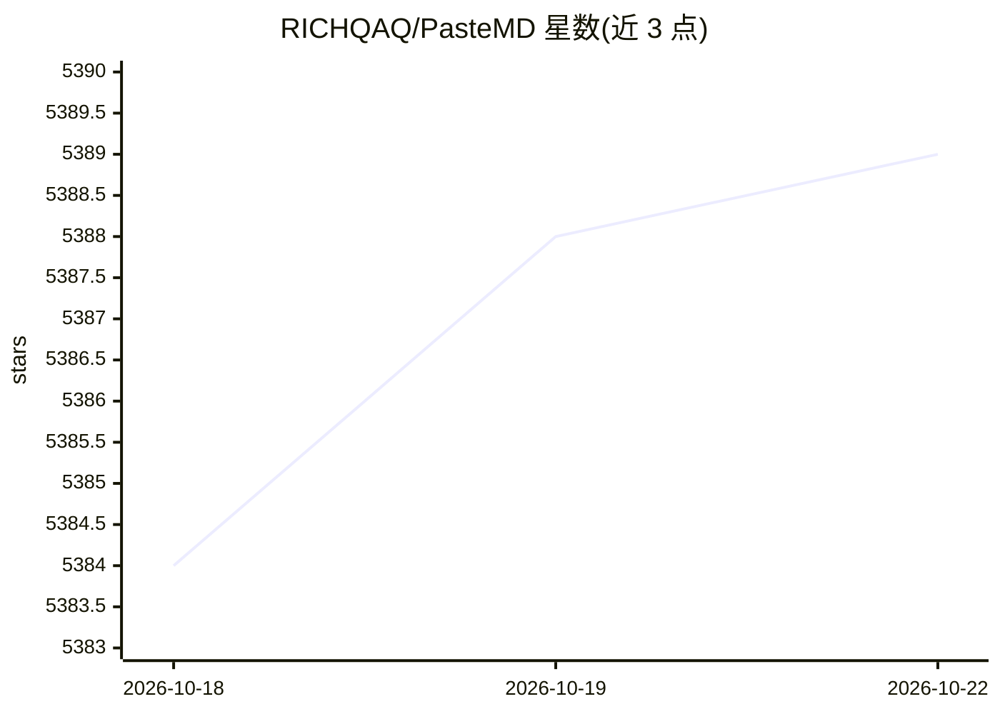

# RICHQAQ/PasteMD

⭐ 5,389 · Python · AGPL-3.0 · 推送 2026-10-10 · [GitHub](https://github.com/RICHQAQ/PasteMD) · [官网](https://pastemd.richqaq.cn/) · 个人维护 · 中文 README

**常驻托盘工具：一键把 Markdown/AI 网页回复粘贴进 Word/WPS/Excel**

面向 Windows/macOS 用户的剪贴板转换工具：从剪贴板读取 Markdown 或 HTML 富文本，调用 Pandoc 转换为 DOCX 并通过全局热键（默认 Ctrl+Shift+B）自动插入 Word/WPS 光标位置；智能识别 Markdown 表格粘贴到 Excel。支持按应用/窗口标题配置 HTML/Markdown/LaTeX/文件粘贴模式，可自定义 Pandoc Filters 扩展转换（如 Mermaid 图表），并自动修复部分 LaTeX 语法。提供自带 Pandoc 的一体化安装包，也可用 Python 3.12 从源码运行。

## 筛选速览

| 维度 | 判定 | 备注 |
|---|---|---|
| AI 角色 | `ai-enhanced` | 去掉 AI 部分产品仍成立 |
| 许可风险 | `viral` | AGPL-3.0 |
| 部署形态 | `desktop` | 安装包/桌面程序 |
| 模型依赖 | — | README 未给出锁定关系 |
| 硬件要求 | — | 无带数字的原话,不猜 |
| 安装摩擦 | `low` | 无编译、无系统依赖或容器化 |
| 成熟度 | — | 结构信号不足 |

## 能力要点

- 剪贴板 Markdown/HTML → Pandoc → DOCX 自动插入 Word/WPS 光标处
- 智能识别 Markdown 表格并粘贴到 Excel
- 按应用/窗口标题配置 HTML/Markdown/LaTeX/文件粘贴模式
- 自定义 Pandoc Filters 与 LaTeX 语法自动修复

## 适用场景

- 写论文时把 ChatGPT/DeepSeek 等网站复制的含公式内容粘到 Word 不乱码
- 把 Markdown 表格一键粘贴到 Excel
- 为语雀、Overleaf、QQ 等不同应用配置各自粘贴方式

## 场景标签

 · 领域:办公效率/文档转换

## 证据(README 行号)

> L54: 一个常驻托盘的小工具：
> L57: **✨ 功能**：智能识别 Markdown 表格，一键粘贴到 **Excel**！
> L99: |AI 网站|复制 Markdown （无公式）|复制 Markdown （含公式）|复制网页内容 （无公式）|复制网页内容 （含公式）|

## 星数曲线

2026-10-18 5,384 → 2026-10-22 5,389（+5）

---
*卡片 v1 · prompt 1.4 · 生成 2026-10-20 · 置信度 mid · 依据 README sha `104ff4c83c87` · [字段定义](../../DATASET.md)*
