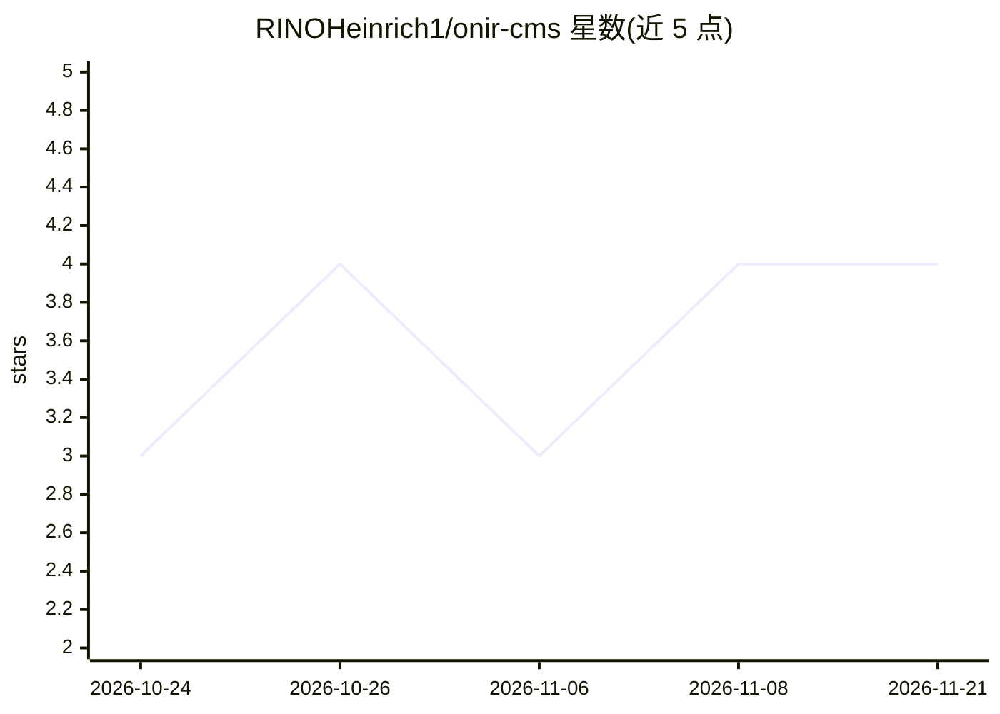

# RINOHeinrich1/onir-cms

⭐ 4 · TypeScript · MIT · 推送 2026-11-20 · [GitHub](https://github.com/RINOHeinrich1/onir-cms) · 组织维护

**自托管 AI 销售线索对话 CMS：公开聊天链接收集并生成线索档案**

基于 Next.js 与 PostgreSQL 的多租户 CMS，用于创建带加密令牌、过期与撤销机制的公开聊天链接，从访客对话中收集合格信息并生成销售线索档案（Markdown/PDF 导出）。推理模型以数据库存储的提示词行为配置，支持 OpenAI 兼容供应商、密钥加密、按链接指派模型，以及知识库/图库等可激活来源。状态为 alpha（0.x），附件不做 OCR 或 AI 分析。

## 筛选速览

| 维度 | 判定 | 备注 |
|---|---|---|
| AI 角色 | `ai-native` | 本体是模型或模型工具 |
| 许可风险 | `permissive` | MIT |
| 部署形态 | `self-host` | docker 或自建部署 |
| 模型依赖 | — | README 未给出锁定关系 |
| 硬件要求 | — | 无带数字的原话,不猜 |
| 安装摩擦 | `low` | 无编译、无系统依赖或容器化 |
| 成熟度 | `idea` | |

## 能力要点

- 带令牌加密、过期、撤销与访客同意的公开聊天链接
- 多租户组织/角色/数据隔离管理
- OpenAI 兼容供应商密钥管理与按链接指派模型
- 线索档案生成、文件附件与 Markdown/PDF 导出

## 适用场景

- 通过公开聊天链接收集并筛选销售线索
- 一个实例管理多个组织的对话式获客
- 为聊天链接配置知识库与资料来源

## 场景标签

`聊天机器人` · 领域:对话与助手

## 证据(README 行号)

> L3: **ONIR CMS** est un CMS open source de prospection et de conversation assistée par IA.
> L30: - **Fournisseurs IA OpenAI-compatible** : clés chiffrées, catalogue de modèles, modèle par
> L32: - **Multitenancy** : organisations, memberships, rôles et isolation des données.

## 星数曲线

2026-10-24 3 → 2026-11-21 4（+1）

---
*卡片 v1 · prompt 1.4 · 生成 2026-11-21 · 置信度 high · 依据 README sha `680050761790` · [字段定义](../../DATASET.md)*
