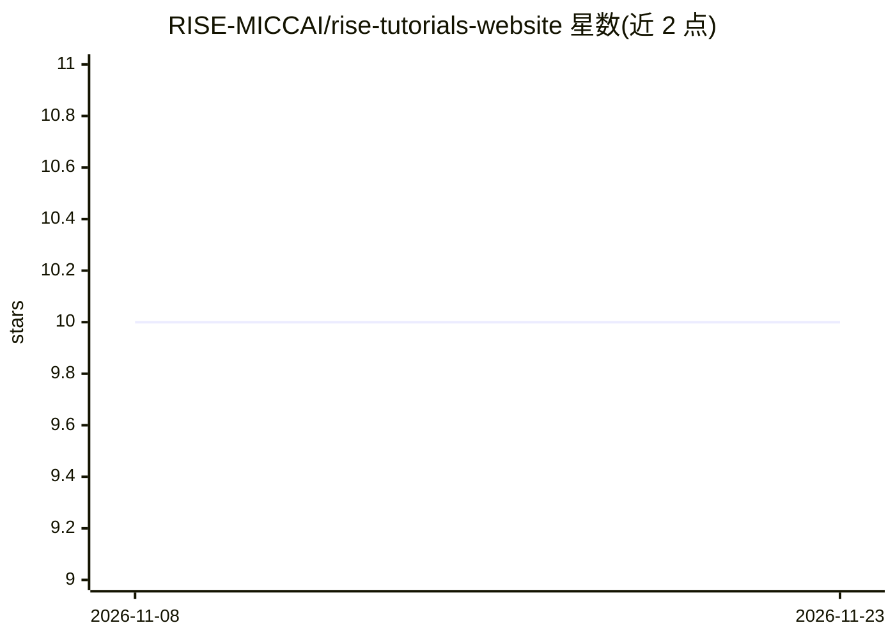

# RISE-MICCAI/rise-tutorials-website

⭐ 10 · Jupyter Notebook · MIT · 推送 2026-04-09 · [GitHub](https://github.com/RISE-MICCAI/rise-tutorials-website) · [官网](https://tutorial.rise-miccai.org/) · 组织维护

**医影像 AI 教程书：面向 MICCAI 学员与研究者**

由 RISE-MICCAI 社区维护的开源教程书源码仓库，使用 Jupyter Book 构建，覆盖医学数据处理（DICOM/NIfTI）、预处理与数据泄漏防范、评价指标（AUROC、敏感度等）、分类/分割模型构建、可解释性工具（Grad-CAM）等主题。教程分状态管理（已完成/进行中/计划中），支持 git clone 后本地构建，可部署至 GitHub Pages/GitLab Pages/Netlify，通过 cookiecutter-jupyter-book 的 CI/CD 自动部署。内容采用 CC BY 4.0 许可，代码许可见各 notebook。

## 筛选速览

| 维度 | 判定 | 备注 |
|---|---|---|
| AI 角色 | `ai-knowledge` | 知识聚合/清单类 |
| 许可风险 | `permissive` | MIT |
| 部署形态 | `None` |  |
| 模型依赖 | — | README 未给出锁定关系 |
| 硬件要求 | — | 无带数字的原话,不猜 |
| 安装摩擦 | `low` | 无编译、无系统依赖或容器化 |
| 成熟度 | — | 结构信号不足 |

## 能力要点

- Jupyter Book 构建的社区医学影像 AI 教程集
- 覆盖 DICOM/NIfTI 数据处理、评价指标、Grad-CAM 可解释性等主题
- 支持 GitHub Pages/GitLab Pages/Netlify 部署与 CI/CD 自动发布
- 内容采用 CC BY 4.0 许可并接受社区贡献

## 适用场景

- 学习医学影像分类/分割模型的最佳实践
- 查阅医学 AI 评价指标与数据预处理方法
- 为 MICCAI 相关课程或培训补充教学材料

## 场景标签

`教程课程` · 领域:学习与行业

## 证据(README 行号)

> L8: **RISE Tutorials** is a collaborative, open-source educational platform developed by the RISE-MICCAI initiative. Our
> L14: This repository hosts the source code and content for the **RISE Tutorials Book**, a continuously evolving resource

## 星数曲线

2026-11-08 10 → 2026-11-23 10（+0）

---
*卡片 v1 · prompt 1.4 · 生成 2026-11-20 · 置信度 high · 依据 README sha `0bbe67666f32` · [字段定义](../../DATASET.md)*
