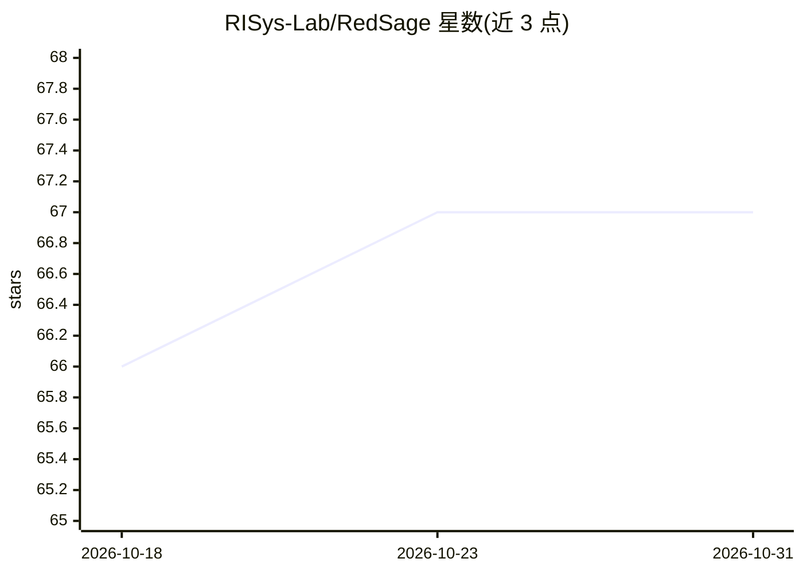

# RISys-Lab/RedSage

⭐ 67 · Python · 推送 2026-08-24 · [GitHub](https://github.com/RISys-Lab/RedSage) · [官网](https://risys-lab.github.io/RedSage/) · 组织维护

**8B 网络安全领域大模型：本地部署的安全专家助手**

ICLR 2026 论文的官方仓库，发布 8B 规模网络安全大模型系列（Base/Instruct/DPO 及消融变体），基于 Qwen3-8B，使用 11.8B token 的 CyberFineWeb 语料持续预训练和 26.6 万条多轮安全对话微调。提供 Transformers 本地推理示例与 vLLM OpenAI 兼容部署方式，附带数据集（CFW/Seed/Conv）、RedSage-Bench 评测套件及 lighteval 实现；训练配置（Axolotl）与部分数据生成代码尚未发布。声明仅供研究与教育用途。

## 筛选速览

| 维度 | 判定 | 备注 |
|---|---|---|
| AI 角色 | `ai-native` | 本体是模型或模型工具 |
| 许可风险 | `none` | — |
| 部署形态 | `library` | 以包/库形式分发 |
| 模型依赖 | local-ok | 支持本地模型 |
| 硬件要求 | — | 无带数字的原话,不猜 |
| 安装摩擦 | `low` | 无编译、无系统依赖或容器化 |
| 成熟度 | — | 结构信号不足 |

## 能力要点

- 基于 Qwen3-8B 的 4 个已发布模型变体（Base/Ins/DPO/CFW）
- CyberFineWeb 11.8B token 网络安全语料与 26.6 万条智能体生成对话
- RedSage-Bench：3 万道选择题 + 240 道开放题评测套件
- 支持 vLLM 高吞吐 OpenAI 兼容部署

## 适用场景

- 本地部署网络安全问答助手，避免敏感数据出域
- 在 CTI-Bench、CyberMetric 等安全基准上评测模型
- 获取网络安全领域预训练语料与对话数据集做后续研究

## 场景标签

`网络安全` `模型评测` · 领域:评测与运维

## 证据(README 行号)

> L64: **RedSage** is an open-source, 8B-scale cybersecurity assistant engineered to tackle complex security workflows wit
> L30: - [x] Publish `RedSage-Qwen3-8B-DPO` on Hugging Face (weights + model card)

## 星数曲线

2026-10-18 66 → 2026-10-31 67（+1）

---
*卡片 v1 · prompt 1.4 · 生成 2026-10-24 · 置信度 mid · 依据 README sha `3a85d086d4fc` · [字段定义](../../DATASET.md)*
