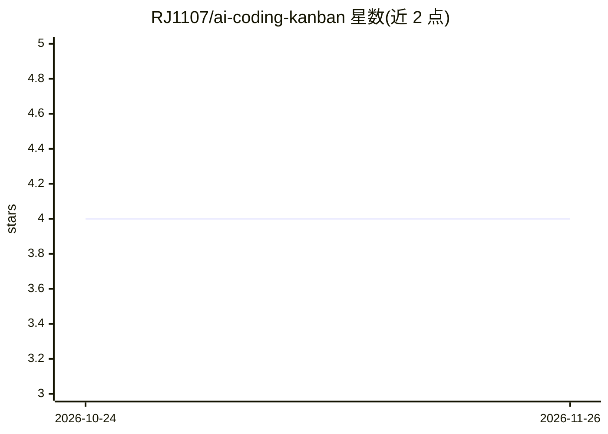

# RJ1107/ai-coding-kanban

⭐ 4 · JavaScript · MIT · 推送 2026-10-26 · [GitHub](https://github.com/RJ1107/ai-coding-kanban) · 个人维护 · 中文 README

**AI 编程代理的实时看板：任务进度、证据与跨代理交接**

一个可移植的 agent skill，为编程助手提供实时看板：代理在里程碑处通过 board.mjs 命令行上报任务状态，卡片在浏览器中实时移动，Done 卡片附带验证证据，支持跨代理复用项目与卡片 ID 进行交接。看板本身无依赖、无构建步骤、无模型 API key，仅需 Node.js 22+ 与文件/命令行权限。支持中英双语卡片、空闲自动停服、多工作区隔离与归档。

## 筛选速览

| 维度 | 判定 | 备注 |
|---|---|---|
| AI 角色 | `ai-enhanced` | 去掉 AI 部分产品仍成立 |
| 许可风险 | `permissive` | MIT |
| 部署形态 | `None` |  |
| 模型依赖 | — | README 未给出锁定关系 |
| 硬件要求 | — | 无带数字的原话,不猜 |
| 安装摩擦 | `low` | 无编译、无系统依赖或容器化 |
| 成熟度 | — | 结构信号不足 |

## 能力要点

- 代理上报时卡片实时移动，无刷新与轮询
- Done 卡片显示验证证据，无证据则标注
- 跨代理交接：复用项目/卡片 ID、更换 owner、保留历史
- 中英双语看板与界面切换，缺失中文副本时标记

## 适用场景

- 让编程代理工作时在编辑器旁实时展示任务进展
- 在不同代理（如 Codex 与 Claude Code）之间交接同一任务
- 任务完成时留存实际验证证据供人工核查

## 场景标签

`编码 Agent` · 领域:编码与开发

## 证据(README 行号)

> L5: A portable skill that puts a live board beside your coding agent. The agent keeps coding and reports at real milesto
> L23: Replace the path with wherever you saved this folder. The agent needs file access, permission to run local commands
> L81: The reporting interface is agent-independent: any coding agent that can read the instructions and run local command

## 星数曲线

2026-10-24 4 → 2026-11-26 4（+0）

---
*卡片 v1 · prompt 1.4 · 生成 2026-11-21 · 置信度 high · 依据 README sha `bdfbde6c7b52` · [字段定义](../../DATASET.md)*
