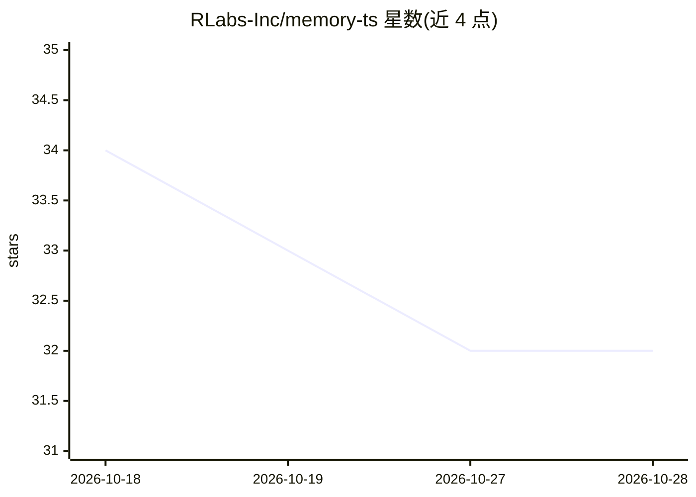

# RLabs-Inc/memory-ts

⭐ 32 · TypeScript · 推送 2026-03-03 · [GitHub](https://github.com/RLabs-Inc/memory-ts) · 组织维护

**为 Claude Code/Gemini CLI 保存跨会话记忆的记忆层**

与 Claude Code 和 Gemini CLI 并行运行的记忆服务器：会话开始注入含时间上下文的 primer，每条消息经 7 信号两阶段检索注入相关记忆（all-MiniLM-L6-v2 384 维嵌入，~5ms），会话结束由同一 CLI 实例通过 --resume 提取并策展记忆，管理 agent 负责取代过时条目、链接关联记忆。记忆以带 YAML frontmatter 的 markdown 存储，分全局/项目两级作用域，支持两个 CLI 并发会话。需 Bun 运行时及对应 CLI，首次运行下载 ~100MB 嵌入模型。

## 筛选速览

| 维度 | 判定 | 备注 |
|---|---|---|
| AI 角色 | `ai-ecosystem` | LLM/agent 周边工具 |
| 许可风险 | `none` | — |
| 部署形态 | `None` |  |
| 模型依赖 | — | README 未给出锁定关系 |
| 硬件要求 | — | 无带数字的原话,不猜 |
| 安装摩擦 | `low` | 无编译、无系统依赖或容器化 |
| 成熟度 | — | 结构信号不足 |

## 能力要点

- 7 信号激活 + 重要性排序的两阶段记忆检索，默认最多注入 5 条
- 会话结束自动策展与异步管理（取代/解决/链接记忆）
- 记忆存为人类可读 markdown + YAML frontmatter，支持 git 版本控制
- Claude Code 与 Gemini CLI 双支持，可并发会话

## 适用场景

- 跨会话保留与 AI 编程助手的上下文与偏好
- 在多个项目中复用全局个人记忆与技术突破
- 用 *** 信号快速取回待办与未决事项

## 场景标签

`Agent 记忆` · 领域:Agent 开发

## 证据(README 行号)

> L3: **Consciousness continuity for Claude Code and Gemini CLI sessions.**
> L15: A memory layer that runs alongside Claude Code:

## 星数曲线

2026-10-18 34 → 2026-10-28 32（-2）

---
*卡片 v1 · prompt 1.4 · 生成 2026-10-25 · 置信度 high · 依据 README sha `6787644c709c` · [字段定义](../../DATASET.md)*
