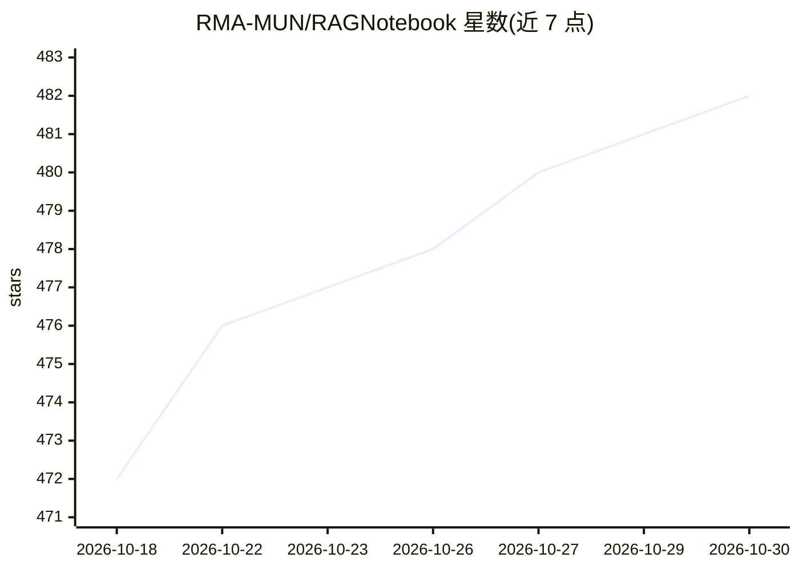

# RMA-MUN/RAGNotebook

⭐ 482 · Python · MIT · 推送 2026-09-15 · [GitHub](https://github.com/RMA-MUN/RAGNotebook) · 组织维护 · 中文 README

**个人知识管理工具：笔记+知识图谱+GraphRAG+AI写作辅助**

基于 FastAPI+LangChain+React 的智能笔记助手，面向需要 AI 管理笔记与知识库的个人及求职者。功能包括 Markdown 笔记管理、LLM 自动打标签、Neo4j 向量+全文混合检索（RRF 融合）、LLM 抽取实体关系构建知识图谱、图谱引导的 Agentic RAG 问答（回答附来源引用）、艾宾浩斯间隔重复回顾、AI 联机补全与续写/扩写/摘要。模型统一走 OpenAI 兼容协议（DeepSeek/百炼/智谱/Moonshot/Ollama 均可），base-rag 分支保留纯 RAG 版本供学习。提供 Docker 一键启动与本地开发两种方式，未配置 LLM Key 时 AI 功能不可用。

## 筛选速览

| 维度 | 判定 | 备注 |
|---|---|---|
| AI 角色 | `ai-native` | 本体是模型或模型工具 |
| 许可风险 | `permissive` | MIT |
| 部署形态 | `self-host` | docker 或自建部署 |
| 模型依赖 | local-ok | 支持本地模型 |
| 硬件要求 | — | 无带数字的原话,不猜 |
| 安装摩擦 | `low` | 无编译、无系统依赖或容器化 |
| 成熟度 | — | 结构信号不足 |

## 能力要点

- Neo4j 向量+全文混合检索（RRF 融合），图谱引导的 Agentic RAG 问答
- LLM 抽取实体关系构建知识图谱并可视化，检索沿图扩展证据
- 笔记管理 + 智能标签 + 艾宾浩斯间隔重复回顾 + AI 写作辅助
- Docker 一键启动（含 MySQL/Redis/Neo4j 五容器），base-rag 分支保留纯 RAG 版本

## 适用场景

- 把散落的笔记和文档汇成可检索问答的个人知识库
- 写笔记时用 AI 补全、续写、摘要并获取相关笔记推荐
- 按遗忘曲线回顾笔记，对抗知识遗忘
- 切换 base-rag 分支学习或快速集成纯 RAG 能力

## 场景标签

`知识库管理` `知识图谱` `RAG` `AI 写作` · 领域:内容生成

## 证据(README 行号)

> L14: AI 驱动的个人知识管理工具，融合 **笔记管理 + neo4j知识图谱 + GraphRAG + AI 写作辅助**，解决"笔记写了从不回看、知识散落成孤岛"的问题。
> L54: - **💬 智能问答**：图谱引导的 Agentic RAG 对话，回答附知识图谱与笔记来源引用

## 星数曲线

2026-10-18 472 → 2026-10-30 482（+10）

---
*卡片 v1 · prompt 1.4 · 生成 2026-10-21 · 置信度 mid · 依据 README sha `802d1da8fc3a` · [字段定义](../../DATASET.md)*
