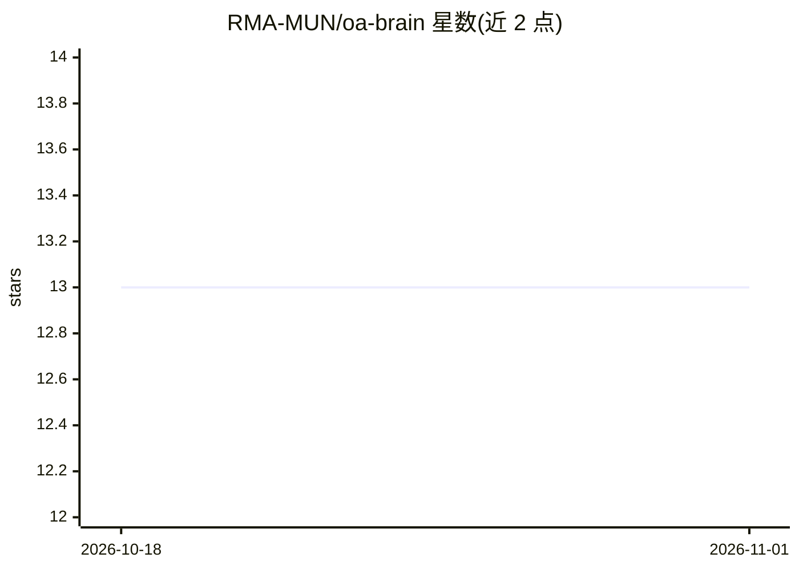

# RMA-MUN/oa-brain

⭐ 13 · Python · MIT · 推送 2026-06-19 · [GitHub](https://github.com/RMA-MUN/oa-brain) · 组织维护 · 中文 README

**前后端分离的 AI 办公系统：多Agent协作+RAG知识库问答**

对原有 DjangoOA 系统重构的微服务架构智能办公自动化系统，由 Django 后端（用户认证、考勤、员工、文件、通知等业务 API）、Vue 3 前端与 FastAPI AI 服务组成。AI 侧基于 LangChain/LangGraph 实现 7 个 Agent 的协作流程（任务分解、路由、工具调用、RAG 知识查询、记忆管理、参数提取），LLM 支持 Ollama 与阿里云百炼，向量数据库用 ChromaDB。启动需分别运行三个子服务，各子服务启动方式见其各自 README。

## 筛选速览

| 维度 | 判定 | 备注 |
|---|---|---|
| AI 角色 | `ai-native` | 本体是模型或模型工具 |
| 许可风险 | `permissive` | MIT |
| 部署形态 | `None` |  |
| 模型依赖 | local-ok | 支持本地模型 |
| 硬件要求 | — | 无带数字的原话,不猜 |
| 安装摩擦 | `low` | 无编译、无系统依赖或容器化 |
| 成熟度 | — | 结构信号不足 |

## 能力要点

- MainAgent 调度 7 类子Agent 的多Agent协作流程
- 基于 RAG 的企业知识库问答
- 多轮对话与会话记忆管理
- LLM 支持 Ollama / 阿里云百炼两种后端

## 适用场景

- 企业内部考勤、请假、员工、文件、通知等日常办公事务
- 用自然语言让 AI 代为查询与执行 OA 业务操作
- 基于企业知识库做 RAG 智能问答

## 场景标签

`文档问答` `RAG` `多智能体` · 领域:Agent 开发

## 证据(README 行号)

> L10: - **知识库问答**：基于RAG技术实现企业知识的智能检索和问答
> L20: - **FastAPI AI服务**：提供多Agent协作、RAG知识库等智能服务
> L34: 用户请求 → MainAgent(主调度)

## 星数曲线

2026-10-18 13 → 2026-11-01 13（+0）

---
*卡片 v1 · prompt 1.4 · 生成 2026-10-31 · 置信度 high · 依据 README sha `706372ed4fd4` · [字段定义](../../DATASET.md)*
