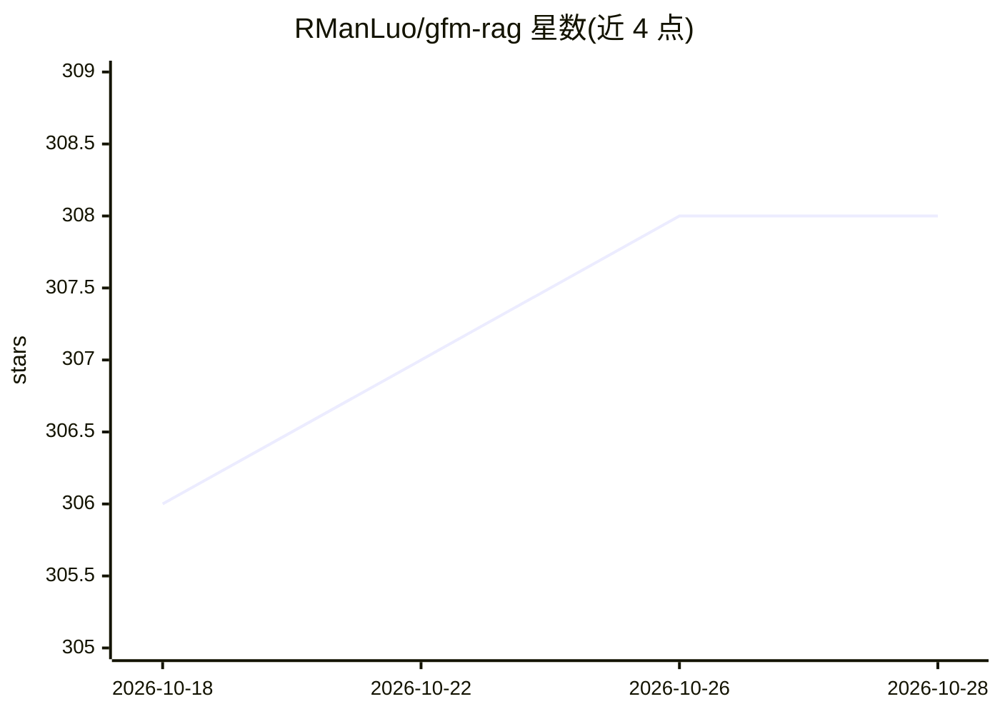

# RManLuo/gfm-rag

⭐ 308 · Python · Apache-2.0 · 推送 2026-09-08 · [GitHub](https://github.com/RManLuo/gfm-rag) · [官网](https://rmanluo.github.io/gfm-rag/) · 个人维护 · 中文 README

**面向开发者的图基础模型 RAG 检索框架，图上多跳推理检索文档**

基于图神经网络预训练的图基础模型（GFM）检索器构建的 RAG 框架：先从文档构建图索引，再将查询与图索引输入预训练 GFM 检索器获取相关文档供 LLM 生成。检索器经 286 个知识图谱大规模训练，可直接用于未见数据集，也可在自有数据上微调（多 GPU/多节点支持）。提供统一图接口：已有 nodes/relations/edges 三文件格式图可跳过建索引直接使用。依赖 Python 3.12 与 CUDA 12 及以上，通过 pip 安装，附 GFM-RAG-8M 与 G-reasoner-34M 预训练检查点。成果发表于 NeurIPS 2025 与 ICLR 2026。

## 筛选速览

| 维度 | 判定 | 备注 |
|---|---|---|
| AI 角色 | `ai-ecosystem` | LLM/agent 周边工具 |
| 许可风险 | `permissive` | Apache-2.0 |
| 部署形态 | `library` | 以包/库形式分发 |
| 模型依赖 | — | README 未给出锁定关系 |
| 硬件要求 | — | 无带数字的原话,不猜 |
| 安装摩擦 | `medium` | 含编译或系统依赖之一 |
| 成熟度 | — | 结构信号不足 |

## 能力要点

- 预训练图基础模型检索器，无需微调即可用于未见数据集
- 单步检索完成多跳推理，支持展示推理路径
- 统一图接口：已有三文件格式图可直接加载，跳过建索引
- 支持自有数据集微调（多 GPU / 多节点训练）

## 适用场景

- 在自有文档上构建图索引并做基于图的检索问答
- 把已有知识图谱直接接入 RAG 检索流程
- 在特定领域数据上微调 GFM 检索器以提升检索效果

## 场景标签

`RAG` `知识图谱` `微调` · 领域:知识与检索

## 证据(README 行号)

> L20: The GFM-RAG is the first graph foundation model-powered RAG pipeline that combines the power of graph neural networ
> L22: We first build a graph-index from the documents to capture the relationships between knowledge. Then, we feed the q
> L32: - **[2025-09-19]** We are excited to share that GFM-RAG has been accepted by NeurIPS 2025.

## 星数曲线

2026-10-18 306 → 2026-10-28 308（+2）

---
*卡片 v1 · prompt 1.4 · 生成 2026-10-21 · 置信度 high · 依据 README sha `a9e2c599b51e` · [字段定义](../../DATASET.md)*
