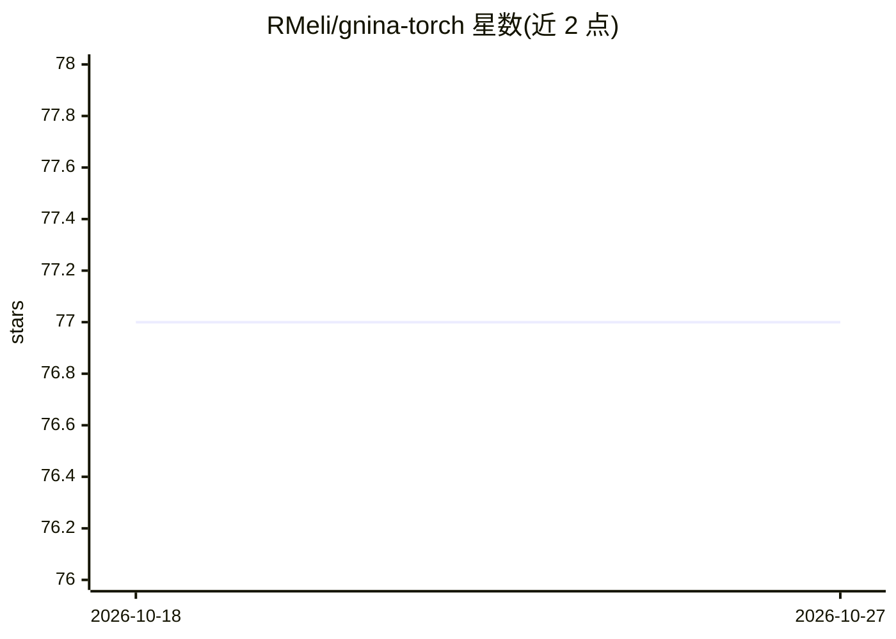

# RMeli/gnina-torch

⭐ 77 · Python · MIT · 推送 2026-04-21 · [GitHub](https://github.com/RMeli/gnina-torch) · [官网](https://gnina-torch.rtfd.io) · 个人维护

**GNINA 分子对接评分函数的 PyTorch 实现，供训练与推理**

将 GNINA 的 CNN 评分函数从 Caffe 迁移到 PyTorch，提供预训练模型（default、default2018、dense 等，已从 Caffe 转换）的加载与推理，以及模型训练模块；训练与推理设计参照原 Caffe 实现，但未实现全部功能。模型可转换为 GNINA 可用格式接入其对接流程。依赖 PyTorch、PyTorch-Ignite 与 libmolgrid，通过 conda 环境加 pip 安装，面向计算化学/药物发现研究者。

## 筛选速览

| 维度 | 判定 | 备注 |
|---|---|---|
| AI 角色 | `ai-native` | 本体是模型或模型工具 |
| 许可风险 | `permissive` | MIT |
| 部署形态 | `library` | 以包/库形式分发 |
| 模型依赖 | — | README 未给出锁定关系 |
| 硬件要求 | — | 无带数字的原话,不猜 |
| 安装摩擦 | `low` | 无编译、无系统依赖或容器化 |
| 成熟度 | — | 结构信号不足 |

## 能力要点

- 提供从 Caffe 转换的 GNINA 预训练模型加载与推理
- 训练模块可复现评分函数训练流程
- 模型可转换为 GNINA 可用格式接入对接管线
- examples 目录含训练与推理完整示例

## 适用场景

- 加载 GNINA 预训练 CNN 模型做蛋白-配体打分推理
- 在 PyTorch 下训练自定义分子对接评分模型
- 将 PyTorch 模型转供 GNINA 对接流程使用

## 场景标签

 · 领域:计算化学/药物发现

## 证据(README 行号)

> L9: PyTorch implementation of GNINA scoring function.

## 星数曲线

2026-10-18 77 → 2026-10-27 77（+0）

---
*卡片 v1 · prompt 1.4 · 生成 2026-10-24 · 置信度 high · 依据 README sha `b1b4599247f6` · [字段定义](../../DATASET.md)*
