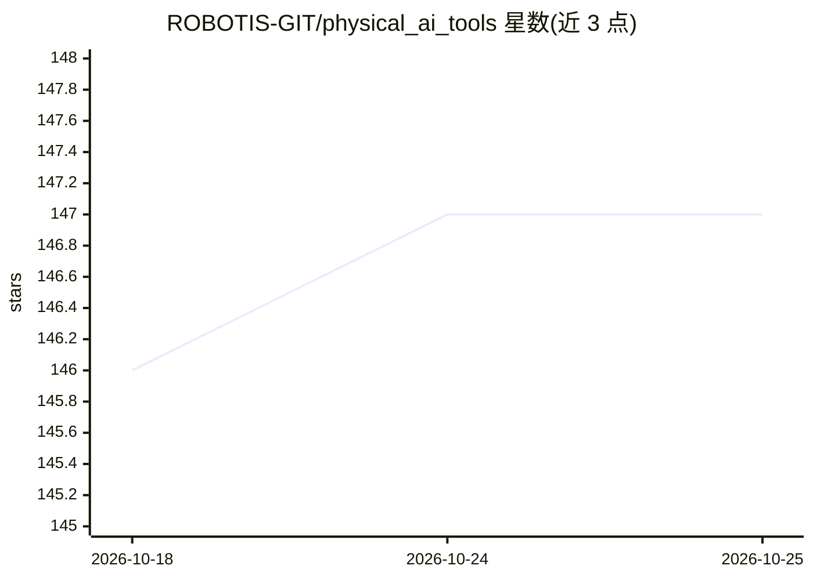

# ROBOTIS-GIT/physical_ai_tools

⭐ 147 · JavaScript · Apache-2.0 · 推送 2026-06-26 · [GitHub](https://github.com/ROBOTIS-GIT/physical_ai_tools) · [官网](https://ai.robotis.com/) · 组织维护

**基于 LeRobot 与 ROS 2 的物理 AI 应用开发接口**

ROBOTIS 维护的仓库，提供使用 LeRobot 和 ROS 2 开发物理 AI 应用的接口，面向 AI Worker 机器人平台。README 给出 git clone 递归克隆（jazzy 分支）的获取方式，并链接到 AI Worker 的 ROS 2 包、仿真模型、教程视频、数据集与预训练模型，以及运行 ROS 包和工具的 Docker 镜像。内容以链接索引为主，具体使用细节在文档站中。

## 筛选速览

| 维度 | 判定 | 备注 |
|---|---|---|
| AI 角色 | `ai-ecosystem` | LLM/agent 周边工具 |
| 许可风险 | `permissive` | Apache-2.0 |
| 部署形态 | `None` |  |
| 模型依赖 | — | README 未给出锁定关系 |
| 硬件要求 | — | 无带数字的原话,不猜 |
| 安装摩擦 | `low` | 无编译、无系统依赖或容器化 |
| 成熟度 | — | 结构信号不足 |

## 能力要点

- 提供 LeRobot + ROS 2 的物理 AI 开发接口
- 链接 AI Worker 的数据集与预训练模型
- 提供运行 ROS 包与工具的 Docker 镜像
- 支持在仿真环境中体验开源机器人平台

## 适用场景

- 为 AI Worker 平台搭建物理 AI 开发环境
- 获取机器人学习的数据集与预训练模型
- 在仿真中试用 ROBOTIS 开源机器人平台

## 场景标签

`教程课程` · 领域:学习与行业

## 证据(README 行号)

> L3: This repository offers an interface for developing physical AI applications using LeRobot and ROS 2. For detailed us
> L24:  - Docker Images

## 星数曲线

2026-10-18 146 → 2026-10-25 147（+1）

---
*卡片 v1 · prompt 1.4 · 生成 2026-10-22 · 置信度 mid · 依据 README sha `680f09ad27cc` · [字段定义](../../DATASET.md)*
