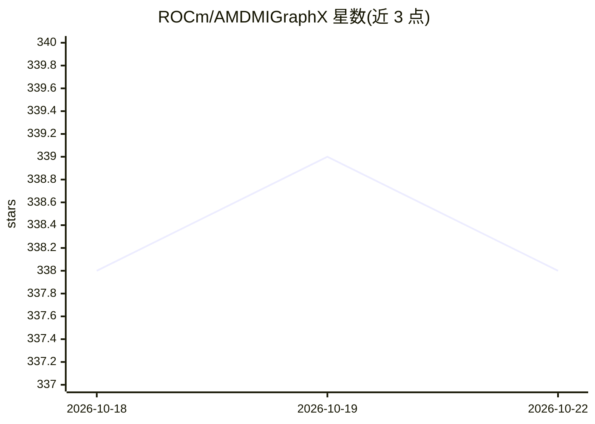

# ROCm/AMDMIGraphX

⭐ 338 · C++ · MIT · 推送 2026-10-21 · [GitHub](https://github.com/ROCm/AMDMIGraphX) · [官网](https://rocm.docs.amd.com/projects/AMDMIGraphX/en/latest/) · 组织维护

**AMD GPU 机器学习模型推理加速的图优化引擎**

AMD MIGraphX 是 AMD 的图推理引擎，用于加速机器学习模型推理，运行于 ROCm 平台之上。它读取 ONNX 模型文件，在 AMD GPU 上做图优化并执行推理，提供 C/C++ API 与 Python 绑定，支持模型序列化为 JSON 与二进制格式，并通过 SQLite3 记录内核调优信息。安装前必须先装 ROCm；提供 apt 二进制安装、rbuild/CMake 源码编译及 Docker 开发环境三种途径。构建依赖包括 MIOpen、rocBLAS、HIP、Protobuf 等。

## 筛选速览

| 维度 | 判定 | 备注 |
|---|---|---|
| AI 角色 | `ai-ecosystem` | LLM/agent 周边工具 |
| 许可风险 | `permissive` | MIT |
| 部署形态 | `self-host` | docker 或自建部署 |
| 模型依赖 | — | README 未给出锁定关系 |
| 硬件要求 | — | 无带数字的原话,不猜 |
| 安装摩擦 | `low` | 无编译、无系统依赖或容器化 |
| 成熟度 | — | 结构信号不足 |

## 能力要点

- 读取 ONNX 模型并在 AMD GPU 上加速推理
- 提供 C/C++ API 与 Python 模块（pybind11 绑定）
- 模型可序列化为 JSON/MessagePack 格式
- 支持 rbuild、CMake、Docker 三种源码构建方式

## 适用场景

- 在 AMD GPU 上部署和加速 ONNX 模型推理
- 在 CMake 项目中通过 C++ API 调用 MIGraphX 推理
- 用 Docker 搭建 ROCm 开发环境编译运行

## 场景标签

`推理引擎` · 领域:训练与推理

## 证据(README 行号)

> L3: AMD MIGraphX is AMD's graph inference engine, which accelerates machine learning model inference.
> L9: > You must install ROCm before

## 星数曲线

2026-10-18 338 → 2026-10-22 338（+0）

---
*卡片 v1 · prompt 1.4 · 生成 2026-10-21 · 置信度 mid · 依据 README sha `2ac21f8331d9` · [字段定义](../../DATASET.md)*
