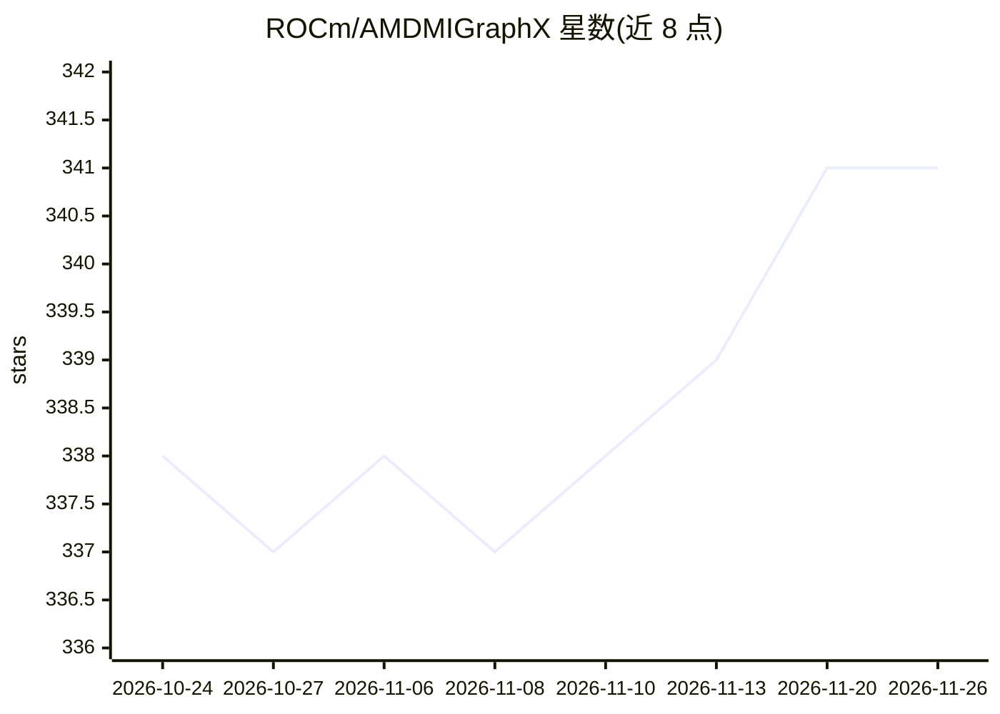

# ROCm/AMDMIGraphX

⭐ 341 · C++ · MIT · 推送 2026-11-25 · [GitHub](https://github.com/ROCm/AMDMIGraphX) · [官网](https://rocm.docs.amd.com/projects/AMDMIGraphX/en/latest/) · 组织维护

**AMD GPU 上的机器学习模型推理图优化引擎**

AMD MIGraphX 是 ROCm 生态中的图推理引擎，用于加速机器学习模型的推理执行。README 覆盖安装（发行版包管理器、pip、tarball）、三种源码构建方式（rbuild、CMake、Docker）及构建前置依赖（MIOpen、rocBLAS、HIP、Protobuf 等），并提供 Python 模块（PYTHONPATH 或 deb 包）与 C/C++ CMake API 的接入方式，另含文档构建与代码格式化说明。使用前必须先安装 ROCm。

## 筛选速览

| 维度 | 判定 | 备注 |
|---|---|---|
| AI 角色 | `ai-ecosystem` | LLM/agent 周边工具 |
| 许可风险 | `permissive` | MIT |
| 部署形态 | `self-host` | docker 或自建部署 |
| 模型依赖 | — | README 未给出锁定关系 |
| 硬件要求 | — | 无带数字的原话,不猜 |
| 安装摩擦 | `low` | 无编译、无系统依赖或容器化 |
| 成熟度 | — | 结构信号不足 |

## 能力要点

- 通过包管理器、pip 或 tarball 安装，也可用 rbuild/CMake/Docker 从源码构建
- 提供 Python 模块与 C/C++ CMake API（find_package(migraphx)）
- 读取 ONNX 模型文件（依赖 Protobuf）
- 多种 Dockerfile 支持 ROCm 7.2.x 及更早版本与 Ubuntu 22.04/24.04

## 适用场景

- 在 AMD GPU 上部署机器学习模型的推理加速
- 将 ONNX 模型编译并在 ROCm 环境中运行推理
- 为 C++/Python 应用接入 MIGraphX 推理库

## 场景标签

`推理引擎` · 领域:训练与推理

## 证据(README 行号)

> L3: AMD MIGraphX is AMD's graph inference engine, which accelerates machine learning model inference.
> L9: > You must install ROCm before

## 星数曲线

2026-10-24 338 → 2026-11-26 341（+3）

---
*卡片 v1 · prompt 1.4 · 生成 2026-11-26 · 置信度 high · 依据 README sha `99bc441cbca6` · [字段定义](../../DATASET.md)*
