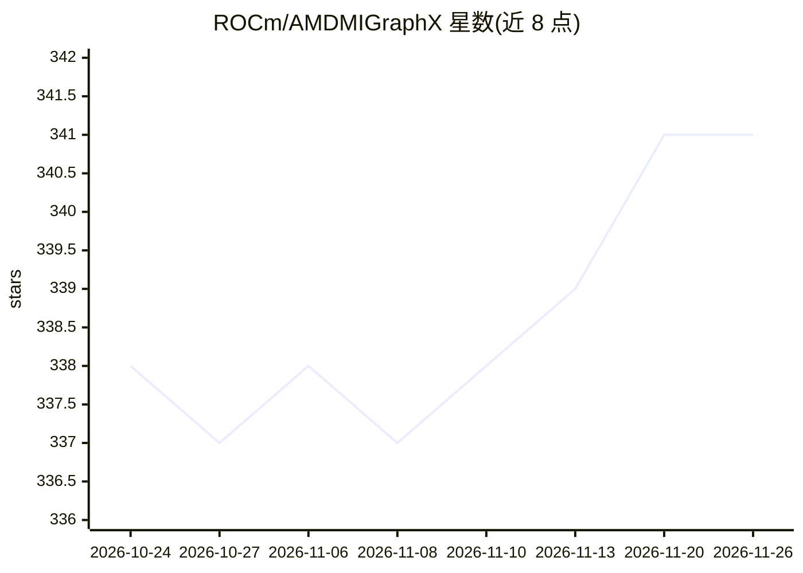

# ROCm/AMDMIGraphX

⭐ 341 · C++ · MIT · 推送 2026-11-25 · [GitHub](https://github.com/ROCm/AMDMIGraphX) · [官网](https://rocm.docs.amd.com/projects/AMDMIGraphX/en/latest/) · 组织维护

**AMD GPU 上的机器学习模型推理图优化引擎**

AMD MIGraphX 是 ROCm 生态中的图推理引擎，用于加速机器学习模型推理。README 覆盖安装与构建：可通过 Linux 发行版包管理器、pip 或 tarball 安装二进制包，也可用 rbuild、CMake 或 Docker 从源码构建。构建依赖 ROCm、MIOpen、rocBLAS、HIP 等 GPU 运行组件，以及 Protobuf、pybind11 等库；支持 Python 模块与 C/C++ API 调用（CMake find_package）。安装前提是先安装 ROCm。

## 筛选速览

| 维度 | 判定 | 备注 |
|---|---|---|
| AI 角色 | `ai-ecosystem` | LLM/agent 周边工具 |
| 许可风险 | `permissive` | MIT |
| 部署形态 | `self-host` | docker 或自建部署 |
| 模型依赖 | — | README 未给出锁定关系 |
| 硬件要求 | — | 无带数字的原话,不猜 |
| 安装摩擦 | `low` | 无编译、无系统依赖或容器化 |
| 成熟度 | — | 结构信号不足 |

## 能力要点

- 提供二进制安装（发行版包管理器/pip/tarball）与源码构建（rbuild/CMake/Docker）
- 支持 Python 模块与 C/C++ API（CMake find_package 集成）
- 提供多个 Dockerfile（TheRock 默认与 legacy/Ubuntu 24.04/22.04 变体）
- 模型序列化支持 JSON 与 MessagePack 格式

## 适用场景

- 在 AMD GPU 上加速深度学习模型推理部署
- 将推理引擎以 C++ 库集成进自有应用
- 在 Docker 容器中搭建 ROCm 开发环境

## 场景标签

`推理引擎` · 领域:训练与推理

## 证据(README 行号)

> L3: AMD MIGraphX is AMD's graph inference engine, which accelerates machine learning model inference.
> L39: * MIOpen for running on the GPU

## 星数曲线

2026-10-24 338 → 2026-11-26 341（+3）

---
*卡片 v1 · prompt 1.4 · 生成 2026-11-25 · 置信度 high · 依据 README sha `606042e58967` · [字段定义](../../DATASET.md)*
