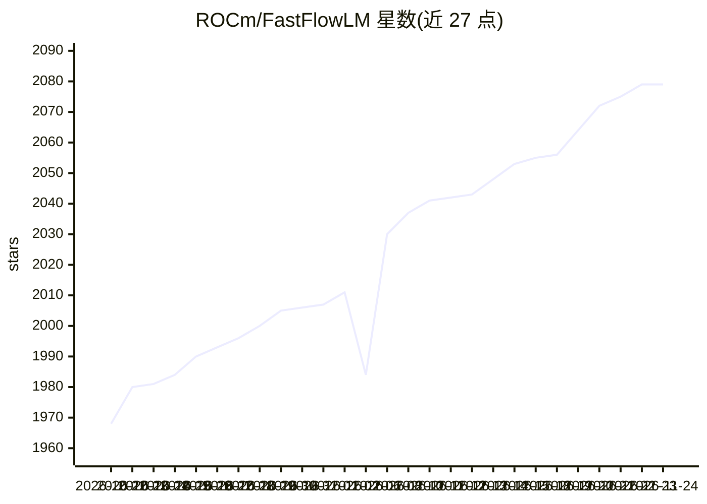

# ROCm/FastFlowLM

⭐ 2,079 · C++ · NOASSERTION · 推送 2026-11-22 · [GitHub](https://github.com/ROCm/FastFlowLM) · [官网](http://fastflowlm.com/) · 组织维护 · 中文 README

**在 AMD Ryzen AI NPU 上本地运行 LLM 的轻量运行时**

面向 AMD Ryzen AI 系列（XDNA2 NPU）芯片的本地模型运行时，提供单命令 CLI（flm run/serve）与本地服务器（默认端口 52625，REST 与 OpenAI API），支持文本、视觉、音频、嵌入与 MoE 模型，上下文最长 256k tokens。运行时 17 MB，模型内核经 HuggingFace 下载；Windows 提供 MSI 安装包，Linux 有入门指南；也可用 CMake 从源码构建。编排代码与 CLI 为 MIT 许可，NPU 二进制内核不开源但可免费使用与再分发。

## 筛选速览

| 维度 | 判定 | 备注 |
|---|---|---|
| AI 角色 | `ai-ecosystem` | LLM/agent 周边工具 |
| 许可风险 | `none` | NOASSERTION |
| 部署形态 | `desktop` | 安装包/桌面程序 |
| 模型依赖 | — | README 未给出锁定关系 |
| 硬件要求 | `cpu-ok` | |
| 安装摩擦 | `medium` | 含编译或系统依赖之一 |
| 成熟度 | — | 结构信号不足 |

## 能力要点

- 单命令 CLI 与本地服务器模式，提供 REST 与 OpenAI 兼容 API
- 支持视觉、音频、嵌入与 MoE 模型，上下文最长 256k tokens
- 运行时 17 MB，完全在 NPU 上运行，无需 GPU
- 已并入 AMD ROCm 组织，并集成进 Lemonade Server

## 适用场景

- 在带 Ryzen AI NPU 的 PC 上离线私有运行 LLM/VLM
- 本地起 OpenAI 兼容 API 供应用调用
- 在无 GPU 设备上运行 VLA 机器人策略模型（SmolVLA）

## 场景标签

`推理引擎` · 领域:训练与推理

## 证据(README 行号)

> L5: ## ⚡ FastFlowLM (FLM) — Unlock Ryzen™ AI NPUs
> L10: 📦 **The only out-of-box, NPU-first runtime built exclusively for Ryzen™ AI.**
> L85: - 🧰 Simple CLI and API (REST and OpenAI API)

## 星数曲线

2026-10-21 1,968 → 2026-11-24 2,079（+111）

---
*卡片 v1 · prompt 1.4 · 生成 2026-11-23 · 置信度 high · 依据 README sha `39123c69a356` · [字段定义](../../DATASET.md)*
