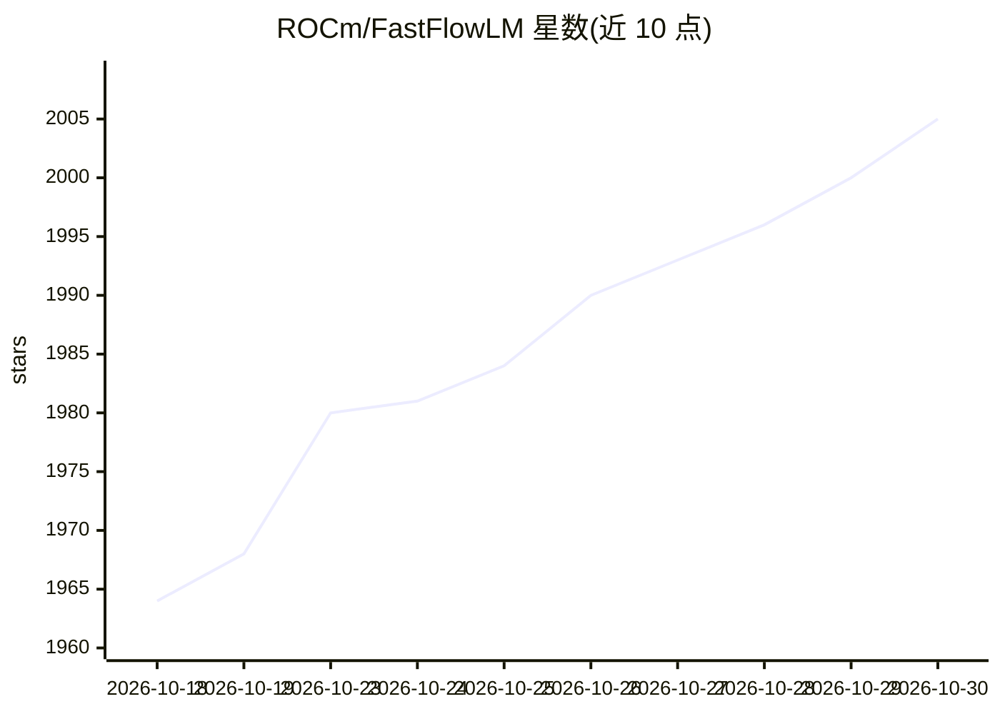

# ROCm/FastFlowLM

⭐ 2,005 · C++ · NOASSERTION · 推送 2026-10-29 · [GitHub](https://github.com/ROCm/FastFlowLM) · [官网](http://fastflowlm.com/) · 组织维护

**面向 AMD Ryzen AI NPU 的本地 LLM 推理运行时与 CLI**

FastFlowLM (FLM) 是专为 AMD Ryzen AI 系列 XDNA2 NPU（Strix、Strix Halo、Kraken、Gorgon Point）构建的本地模型运行时，支持 LLM、视觉、音频、Embedding 与 MoE 模型，上下文最长 256k tokens。提供单命令 CLI（flm run/serve）、REST 与 OpenAI 兼容 API，以及本地服务器模式（默认端口 52625）。安装包含 17 MB 运行时，Windows 提供 msi 安装包，Linux 经源码 CMake 构建或经 Lemonade Server 使用。需 AMD NPU 驱动 32.0.203.311 及以上；编排代码 MIT 开源，NPU 二进制内核闭源但免费可用。

## 筛选速览

| 维度 | 判定 | 备注 |
|---|---|---|
| AI 角色 | `ai-ecosystem` | LLM/agent 周边工具 |
| 许可风险 | `none` | NOASSERTION |
| 部署形态 | `desktop` | 安装包/桌面程序 |
| 模型依赖 | — | README 未给出锁定关系 |
| 硬件要求 | `cpu-ok` | |
| 安装摩擦 | `medium` | 含编译或系统依赖之一 |
| 成熟度 | — | 结构信号不足 |

## 能力要点

- 模型完全运行在 AMD Ryzen AI NPU 上，无需 GPU
- 17 MB 轻量运行时，支持最长 256k tokens 上下文
- 单命令 CLI 与 OpenAI 兼容 API/本地服务器模式
- 支持 Vision、Audio、Embedding 与 MoE 模型

## 适用场景

- 在搭载 Ryzen AI NPU 的 PC 上本地离线运行 LLM/VLM
- 通过 CLI 或 OpenAI 兼容 API 把本地 NPU 推理接入自己的应用
- 在无独显的笔记本上以低功耗跑大模型

## 场景标签

`推理引擎` · 领域:训练与推理

## 证据(README 行号)

> L7: Run large language models — now with **Vision**, **Audio**, **Embedding** and **MoE** support — on **AMD Ryzen™ AI N
> L10: 📦 **The only out-of-box, NPU-first runtime built exclusively for Ryzen™ AI.**
> L83: FLM makes it easy to run cutting-edge **LLMs** (and now **VLMs**) locally with:
> L85: - 🧰 Simple CLI and API (REST and OpenAI API)

## 星数曲线

2026-10-18 1,964 → 2026-10-30 2,005（+41）

---
*卡片 v1 · prompt 1.4 · 生成 2026-10-21 · 置信度 high · 依据 README sha `bb268a1c81e6` · [字段定义](../../DATASET.md)*
