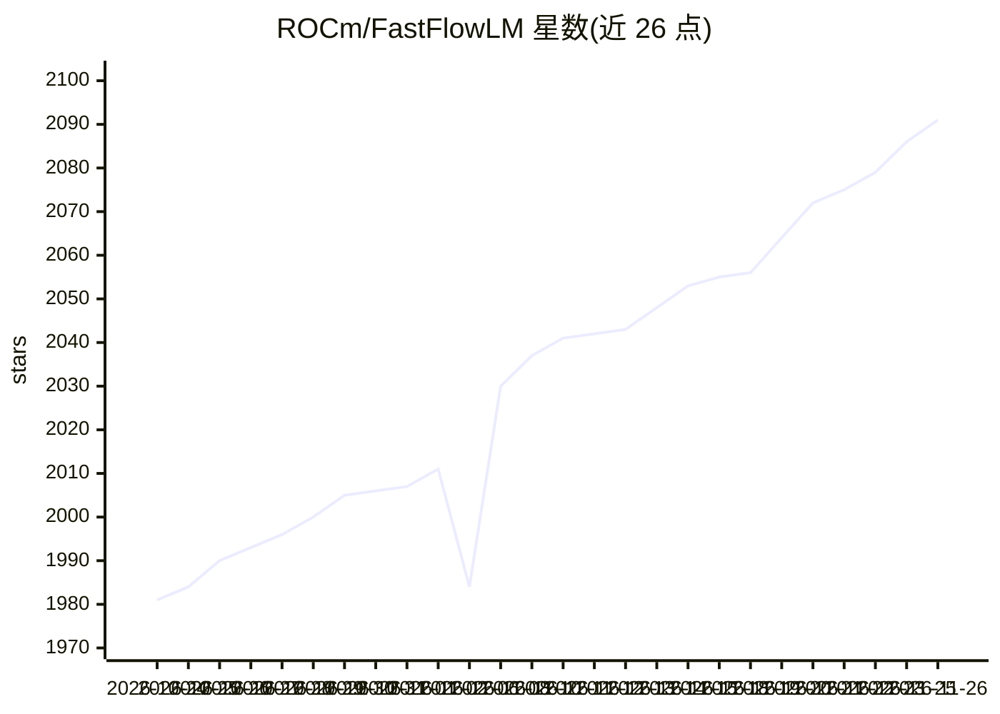

# ROCm/FastFlowLM

⭐ 2,091 · C++ · NOASSERTION · 推送 2026-11-25 · [GitHub](https://github.com/ROCm/FastFlowLM) · [官网](http://fastflowlm.com/) · 组织维护

**在 AMD Ryzen AI NPU 上本地运行 LLM 的运行时**

FastFlowLM（FLM）是一个面向 AMD Ryzen AI 芯片的本地 LLM 运行时，支持视觉、音频、嵌入与 MoE 模型，可在 NPU 与 iGPU 上运行，无需独立显卡。用户通过 flm CLI 一条命令运行模型，也可启动本地服务器（默认端口 52625）并以 REST/OpenAI API 调用。Windows 提供 msi 安装包，亦可从源码 CMake 构建；要求 NPU 驱动 32.0.203.311 以上。编排代码与开发套件为 MIT 许可，NPU 二进制内核不开源但可免费使用。

## 筛选速览

| 维度 | 判定 | 备注 |
|---|---|---|
| AI 角色 | `ai-ecosystem` | LLM/agent 周边工具 |
| 许可风险 | `none` | NOASSERTION |
| 部署形态 | `desktop` | 安装包/桌面程序 |
| 模型依赖 | — | README 未给出锁定关系 |
| 硬件要求 | — | 无带数字的原话,不猜 |
| 安装摩擦 | `medium` | 含编译或系统依赖之一 |
| 成熟度 | — | 结构信号不足 |

## 能力要点

- 17 MB 轻量运行时，支持 NPU 与 iGPU 全 SoC 运行
- CLI 与本地 Server 模式，兼容 REST 与 OpenAI API
- 长上下文最高 256k tokens，支持视觉/音频/嵌入/MoE 模型
- 提供 CMake presets 从源码构建

## 适用场景

- 在 Ryzen AI PC 上离线本地运行 LLM/VLM
- 为本地应用提供 OpenAI 兼容的 API 服务
- 在无独立显卡的设备上运行模型推理

## 场景标签

 · 领域:LLM 基础设施/本地推理

## 证据(README 行号)

> L9: FastFlowLM runs LLMs with **Vision**, **Audio**, **Embedding**, and **MoE** support on AMD Ryzen™ AI, on both the **
> L92: - 🧰 Simple CLI and API (REST and OpenAI API)
> L121: - Inspired by the widely adopted llama.cpp and Ollama

## 星数曲线

2026-10-24 1,981 → 2026-11-26 2,091（+110）

---
*卡片 v1 · prompt 1.4 · 生成 2026-11-24 · 置信度 high · 依据 README sha `291f5c0b61b6` · [字段定义](../../DATASET.md)*
