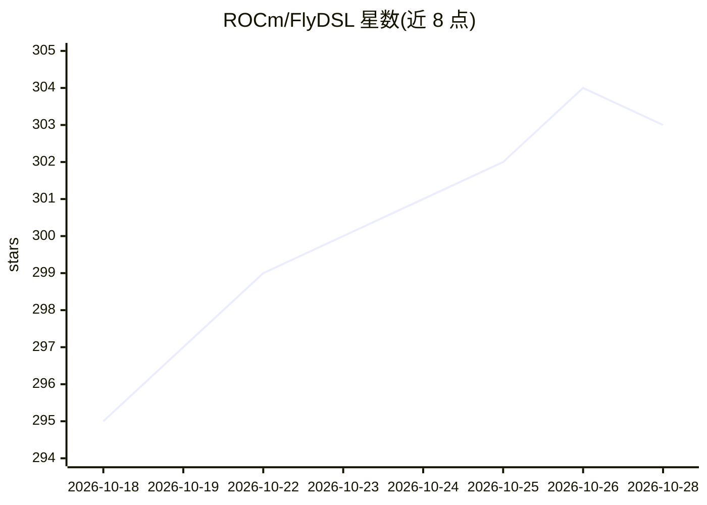

# ROCm/FlyDSL

⭐ 303 · Python · NOASSERTION · 推送 2026-10-28 · [GitHub](https://github.com/ROCm/FlyDSL) · 组织维护

**面向 AMD GPU 的 Python DSL + MLIR 编译栈，用于编写高性能内核**

ROCm/FlyDSL 是一个用于编写高性能 GPU 内核的 Python DSL，配套 MLIR 原生的编译栈：以 fly dialect（布局 IR）为核心，支持在高层表达 tiling、partition、数据移动与内核结构，并提供可组合的 GPU/ROCDL 降级管线。内核以 @flyc.kernel/@flyc.jit 编写，追踪为 MLIR 模块后编译，可导出为可链接的 C 对象，编译结果按类型签名缓存到磁盘。面向 AMD GPU 内核开发者，GPU 执行需 ROCm 6.x/7.x，主要包经 pip 发布，源码构建需自行编译 LLVM/MLIR。测试覆盖 GEMM（FP8/INT8/FP4/BF16）、MoE、注意力等内核，部分仍标注 WIP。

## 筛选速览

| 维度 | 判定 | 备注 |
|---|---|---|
| AI 角色 | `ai-ecosystem` | LLM/agent 周边工具 |
| 许可风险 | `none` | NOASSERTION |
| 部署形态 | `library` | 以包/库形式分发 |
| 模型依赖 | — | README 未给出锁定关系 |
| 硬件要求 | — | 无带数字的原话,不猜 |
| 安装摩擦 | `medium` | 含编译或系统依赖之一 |
| 成熟度 | — | 结构信号不足 |

## 能力要点

- fly dialect 布局 IR：显式代数（composition/product/divide）与坐标映射
- @flyc.kernel/@flyc.jit 将 Python 函数追踪编译为 MLIR 模块，支持导出可链接 C 对象
- 跨 block/warp/thread/instruction 层级的显式 tiling 控制
- 包内置嵌入式 MLIR Python runtime，无需外部 mlir wheel

## 适用场景

- 为 AMD GPU（MI300X/MI350/gfx1250 等）编写与调优 GEMM、注意力等内核
- 在 Python 中以布局代数表达 tiling、swizzle 与数据移动
- 将编译后的内核特化导出为 C 对象供链接复用

## 场景标签

 · 领域:GPU 内核/编译器基础设施

## 证据(README 行号)

> L8: > A Python DSL and a MLIR stack for authoring high‑performance GPU kernels with explicit layouts and tiling.
> L19: - **FlyDSL (Python DSL)**: author kernels in Python, compile them through the Fly dialect,
> L43: - **ROCm**: required for GPU execution, tests, and benchmarks (tested on ROCm 6.x, 7.x)

## 星数曲线

2026-10-18 295 → 2026-10-28 303（+8）

---
*卡片 v1 · prompt 1.4 · 生成 2026-10-21 · 置信度 high · 依据 README sha `ea6555976654` · [字段定义](../../DATASET.md)*
