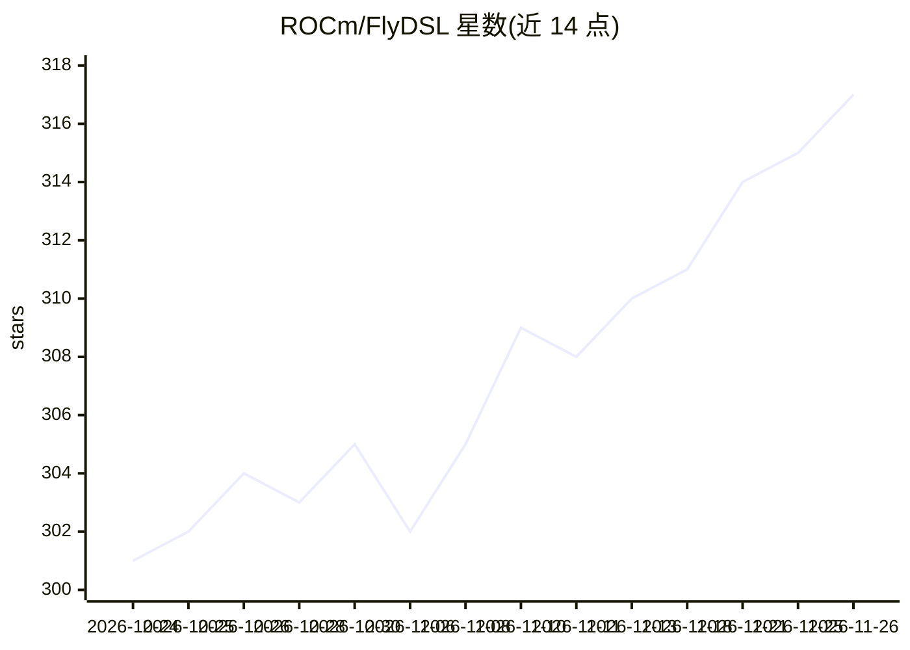

# ROCm/FlyDSL

⭐ 317 · Python · NOASSERTION · 推送 2026-11-25 · [GitHub](https://github.com/ROCm/FlyDSL) · 组织维护

**为 GPU 高性能内核开发提供 Python DSL 与 MLIR 编译栈**

FlyDSL 是 ROCm 项目的 Python 前端 DSL，用布局代数（Shape/Stride/Layout/Coord）在高层表达 tiling、分区、数据搬运与内核结构，经内置 MLIR 编译管线 lowering 到 GPU/ROCDL，支持 @flyc.kernel/@flyc.jit JIT 编译与磁盘缓存，并可导出可链接的 C 对象做 AOT。面向在 AMD GPU 上编写与调优内核的开发者。依赖 ROCm 6.x/7.x 与 Python 3.10+；测试需 ROCm 版 torch；Windows 构建需 VS2022 等工具链。

## 筛选速览

| 维度 | 判定 | 备注 |
|---|---|---|
| AI 角色 | `ai-ecosystem` | LLM/agent 周边工具 |
| 许可风险 | `none` | NOASSERTION |
| 部署形态 | `desktop` | 安装包/桌面程序 |
| 模型依赖 | — | README 未给出锁定关系 |
| 硬件要求 | — | 无带数字的原话,不猜 |
| 安装摩擦 | `medium` | 含编译或系统依赖之一 |
| 成熟度 | — | 结构信号不足 |

## 能力要点

- 基于布局代数的显式 tiling/分区/数据搬运表达
- @flyc.jit 首次调用即追踪为 MLIR 模块并编译，结果磁盘缓存
- 内置 MLIR Python 绑定，无需外部 mlir wheel
- 提供 Claude Code 插件形式的编写/调试/调优技能包

## 适用场景

- 为 AMD MI300X/MI350 等 GPU 编写自定义 GEMM/Attention 内核
- 在高层布局代数上做 tiling、swizzle、MFMA 调度调优
- 将内核 AOT 导出为 C 对象集成到其他工程

## 场景标签

 · 领域:GPU 编译器/深度学习基础设施

## 证据(README 行号)

> L8: > A Python DSL and a MLIR stack for authoring high‑performance GPU kernels with explicit layouts and tiling.
> L14: an end‑to‑end, MLIR‑native compiler stack for GPU kernels. Its core is the `fly` dialect—a first‑class
> L19: - **FlyDSL (Python DSL)**: author kernels in Python, compile them through the Fly dialect,

## 星数曲线

2026-10-24 301 → 2026-11-26 317（+16）

---
*卡片 v1 · prompt 1.4 · 生成 2026-11-25 · 置信度 high · 依据 README sha `0cab7c94806a` · [字段定义](../../DATASET.md)*
