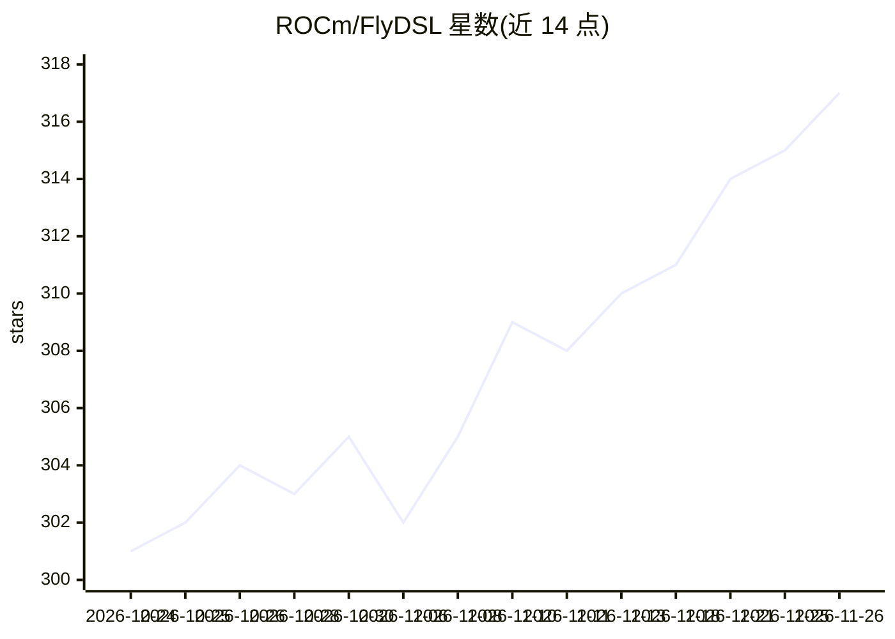

# ROCm/FlyDSL

⭐ 317 · Python · NOASSERTION · 推送 2026-11-25 · [GitHub](https://github.com/ROCm/FlyDSL) · 组织维护

**面向 GPU 开发者的布局代数 Python DSL 与 MLIR 编译栈**

FlyDSL 是 GPU kernel 编写工具链的 Python 前端：通过 layout 代数（Shape/Stride/Layout/Coord）在高层表达 tiling、分区、数据搬运与 kernel 结构，经 @flyc.kernel/@flyc.jit 将 Python 函数追踪为 MLIR 模块，走 Fly dialect 降级到 GPU/ROCDL，编译结果缓存至磁盘并可导出为可链接的 C 对象。用户为编写 AMD GPU kernel 的开发者；安装需 Python 3.10+，GPU 执行需 ROCm 6.x/7.x，源码构建需 LLVM/MLIR 与 C++ 工具链。

## 筛选速览

| 维度 | 判定 | 备注 |
|---|---|---|
| AI 角色 | `ai-ecosystem` | LLM/agent 周边工具 |
| 许可风险 | `none` | NOASSERTION |
| 部署形态 | `desktop` | 安装包/桌面程序 |
| 模型依赖 | — | README 未给出锁定关系 |
| 硬件要求 | — | 无带数字的原话,不猜 |
| 安装摩擦 | `medium` | 含编译或系统依赖之一 |
| 成熟度 | — | 结构信号不足 |

## 能力要点

- layout 代数（composition/product/divide + 坐标映射）显式表达 tiling/swizzle/vectorization
- @flyc.jit 追踪 Python 函数到 MLIR 并经 Fly dialect 降级到 GPU/ROCDL
- JIT 磁盘缓存与 AOT 导出 linkable C 对象
- 发布为 Claude Code plugin 提供 kernel 编写/调试/剖析技能

## 适用场景

- 为 AMD Instinct 与 Radeon GPU 编写自定义 GEMM/Attention/Norm kernel
- 在 Python 中控制 block/warp/thread 各级 tiling 层次并调度 MFMA 指令
- 导出编译产物供 C/C++ 工程链接调用

## 场景标签

 · 领域:深度学习/GPU 编译器

## 证据(README 行号)

> L8: > A Python DSL and a MLIR stack for authoring high‑performance GPU kernels with explicit layouts and tiling.
> L14: an end‑to‑end, MLIR‑native compiler stack for GPU kernels. Its core is the `fly` dialect—a first‑class
> L19: - **FlyDSL (Python DSL)**: author kernels in Python, compile them through the Fly dialect,
> L227: On first call, `@flyc.jit` traces the Python function into an MLIR module, then compiles it through `MlirCompiler`

## 星数曲线

2026-10-24 301 → 2026-11-26 317（+16）

---
*卡片 v1 · prompt 1.4 · 生成 2026-11-26 · 置信度 high · 依据 README sha `e1fcf8efb2d2` · [字段定义](../../DATASET.md)*
