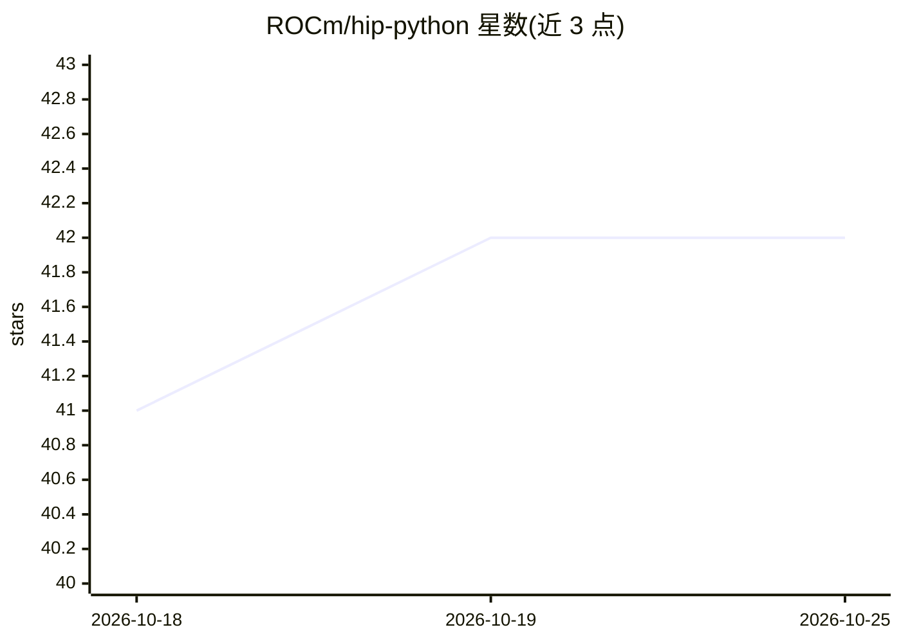

# ROCm/hip-python

⭐ 42 · Cython · MIT · 推送 2026-10-22 · [GitHub](https://github.com/ROCm/hip-python) · [官网](https://rocm.github.io/hip-python/) · 组织维护

**HIP/ROCm 的 Python 与 Cython 底层绑定及 CUDA 互操作层**

AMD ROCm 官方仓库，提供 HIP 及 ROCm 库（hipblas/hipfft/rccl/amdsmi 等）的低层 Python/Cython 绑定，共八个 wheel 包；另含 hip-python-interop 互操作层，使 cuda.bindings、pynvml、nvtx 及最小 cuda.core 代码可在 AMD GPU 上经 HIP 后端运行。Linux 为主要支持平台（PyPI 预编译包仅覆盖 manylinux_2_17_x86_64），Windows 为实验性且仅能从源码构建。运行需系统已安装兼容的 ROCm HIP SDK；源码构建依赖 CMake、Cython 3.1.0 等工具链。

## 筛选速览

| 维度 | 判定 | 备注 |
|---|---|---|
| AI 角色 | `ai-ecosystem` | LLM/agent 周边工具 |
| 许可风险 | `permissive` | MIT |
| 部署形态 | `library` | 以包/库形式分发 |
| 模型依赖 | — | README 未给出锁定关系 |
| 硬件要求 | — | 无带数字的原话,不猜 |
| 安装摩擦 | `high` | 编译与系统依赖俱全 |
| 成熟度 | `idea` | |

## 能力要点

- 八个 wheel 包覆盖 HIP 运行时、数学库、系统库、编译器绑定
- cuda.bindings/pynvml/nvtx/cuda.core 兼容 shim，使 CUDA Python 代码运行于 AMD GPU
- hip.* 命名空间作为 rocm.bindings.* 的别名保持既有代码可用
- 含 numba-hip：Numba 的 ROCm HIP 目标

## 适用场景

- 在 AMD GPU 上直接调用 HIP/ROCm 库编写 Python GPU 程序
- 将现有 CUDA Python 代码迁移到 HIP 后端运行
- 通过 Numba 在 AMD GPU 上做 JIT 编译加速

## 场景标签

 · 领域:GPU 计算/异构计算基础设施

## 证据(README 行号)

> L3: This repository provides low-level Python and Cython Bindings
> L4: for HIP and an interoperability layer for CUDA&reg; Python programs

## 星数曲线

2026-10-18 41 → 2026-10-25 42（+1）

---
*卡片 v1 · prompt 1.4 · 生成 2026-10-25 · 置信度 high · 依据 README sha `d590e26be8e7` · [字段定义](../../DATASET.md)*
