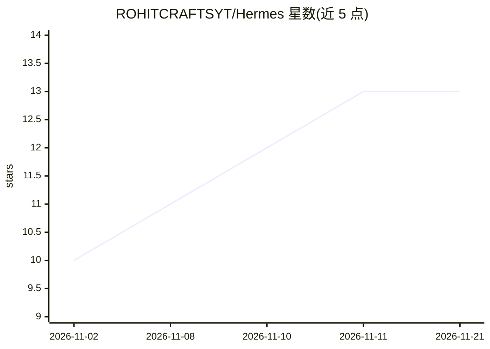

# ROHITCRAFTSYT/Hermes

⭐ 13 · Python · MIT · 推送 2026-11-05 · [GitHub](https://github.com/ROHITCRAFTSYT/Hermes) · 个人维护

**用 ESP32 与本地 Python 大脑搭建的双语语音 AI 助手**

DIY 语音助手项目：ESP32 作为拾音与播放终端，语音推理全部运行在用户现有 PC 上的 Python 服务中。链路由 STT、LLM、TTS 三个阶段组成，通过环境变量选择提供方，失败自动降级到下一家。支持英语/泰米尔语、对话记忆、网页搜索回答、PC 应用与媒体控制、Tuya/MQTT/Home Assistant 智能家居、Chromecast 投屏、定时提醒，并提供手机端 PWA 与多机控制代理。需自备约 ₹1,500–3,000 的硬件并焊接接线。

## 筛选速览

| 维度 | 判定 | 备注 |
|---|---|---|
| AI 角色 | `ai-native` | 本体是模型或模型工具 |
| 许可风险 | `permissive` | MIT |
| 部署形态 | `self-host` | docker 或自建部署 |
| 模型依赖 | local-ok | 支持本地模型 |
| 硬件要求 | — | 无带数字的原话,不猜 |
| 安装摩擦 | `low` | 无编译、无系统依赖或容器化 |
| 成熟度 | — | 结构信号不足 |

## 能力要点

- ESP32 只做拾音播放，AI 推理在 PC 端 Python 服务运行
- STT/LLM/TTS 三段 provider 链，失败自动切换下一提供方
- 英语/泰米尔语双语，带短期与长期记忆
- 覆盖网页搜索、PC 控制、智能家居与投屏的指令面

## 适用场景

- 自制一个可控制电脑与智能家居的桌面语音助手
- 通过手机 PWA 远程向家中 PC 发送语音或文字指令
- 用开源硬件低成本搭建智能音箱替代品

## 场景标签

`语音 Agent` · 领域:对话与助手

## 证据(README 行号)

> L9: Hermes turns a **₹1,500 ESP32** into a hands‑held voice assistant that runs on
> L15: The clever part: the ESP32 is just the *ears and mouth*. All the intelligence
> L26: Each stage is a chain. `STT_PROVIDER`, `LLM_PROVIDER` and `TTS_PROVIDER` pick the first

## 星数曲线

2026-11-02 10 → 2026-11-21 13（+3）

---
*卡片 v1 · prompt 1.4 · 生成 2026-11-18 · 置信度 high · 依据 README sha `69762a5b17bf` · [字段定义](../../DATASET.md)*
