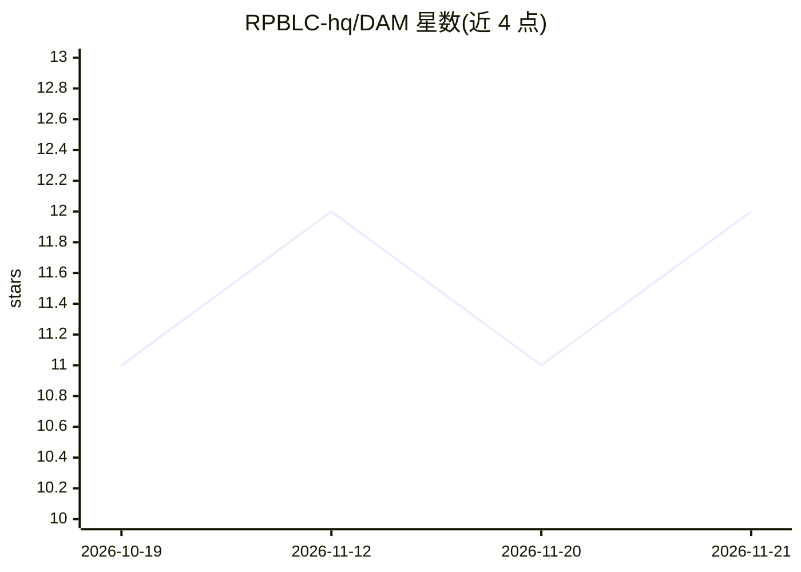

# RPBLC-hq/DAM

⭐ 12 · Rust · 推送 2026-09-15 · [GitHub](https://github.com/RPBLC-hq/DAM) · [官网](http://RPBLC.com/DAM) · 个人维护

**本地隐私防火墙：拦截 AI agent 出站流量中的敏感数据**

以 HTTP(S) 代理形式运行在本机，检测即将发出的请求中的敏感值（邮箱、电话、SSN、Luhn 校验的卡号、多种 API key 家族、PEM 私钥、JWT 等），按本地策略与用户同意（TTL 临时放行）将其替换为稳定引用，原文保留在本地 SQLite vault 中不离开机器。组件包括 daemon、proxy、filter CLI、菜单栏 tray 应用、Web UI 与 MCP server。V1 面向 macOS，Linux/Windows 需源码构建；检测范围目前刻意收窄，姓名、地址、IBAN 等尚未覆盖。

## 筛选速览

| 维度 | 判定 | 备注 |
|---|---|---|
| AI 角色 | `ai-enhanced` | 去掉 AI 部分产品仍成立 |
| 许可风险 | `permissive` | — |
| 部署形态 | `library` | 以包/库形式分发 |
| 模型依赖 | — | README 未给出锁定关系 |
| 硬件要求 | — | 无带数字的原话,不猜 |
| 安装摩擦 | `low` | 无编译、无系统依赖或容器化 |
| 成熟度 | `idea` | |

## 能力要点

- 检测→脱敏→vault 管线，原文永不离开本机
- 基于 TTL 的单值临时放行同意机制，可随时撤销
- 提供 MCP server，agent 可查询状态并管理同意
- npm 包与 cargo 源码构建两种获取方式

## 适用场景

- 让 AI 助手/agent 发请求前自动拦截邮箱、卡号、API key 等敏感信息
- 需要临时放行某个特定值并设定 TTL 后自动收回
- 为面向 agent 的出站流量准备安全审查材料

## 场景标签

`网络安全` · 领域:学习与行业

## 证据(README 行号)

> L19: DAM runs on your machine, between what you send and where it goes. It detects sensitive
> L24: It works on outbound traffic in general. **V1 starts with AI agents, assistants, and
> L144:  cards, common API-key assignment labels, direct OpenAI/Anthropic/GitHub/Stripe/Slack-app-token/Discord/Microsoft 

## 星数曲线

2026-10-19 11 → 2026-11-21 12（+1）

---
*卡片 v1 · prompt 1.4 · 生成 2026-11-18 · 置信度 high · 依据 README sha `45fee22097df` · [字段定义](../../DATASET.md)*
