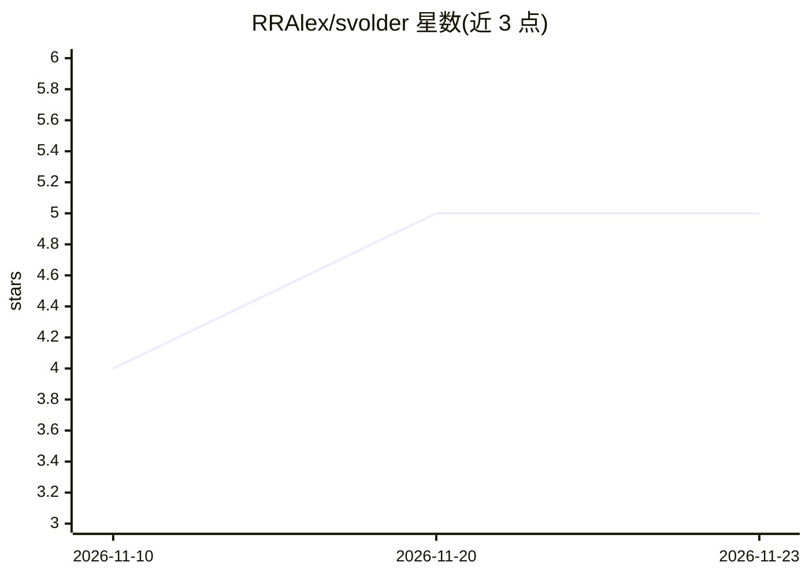

# RRAlex/svolder

⭐ 5 · Rust · GPL-3.0 · 推送 2026-11-19 · [GitHub](https://github.com/RRAlex/svolder) · 个人维护

**从 Linux 控制 Schiit Forkbeard 蓝牙音频设备的 CLI/TUI/守护进程套件**

面向搭载 Schiit Forkbeard Bluetooth LE 模块的 DAC、前级、功放与唱放设备的 Linux 控制工具，提供 CLI、TUI、后台守护进程、Web UI、经 MQTT 接入 Home Assistant，以及供 AI 助手调用的 MCP 服务器。按型号提供设备配置文件，支持音量、静音、音调/EQ（含 AutoEq 检索）、输入切换与遥测读取。README 声明处于 beta 阶段，仅部分型号经真实硬件确认，非 Schiit Audio 官方产品。

## 筛选速览

| 维度 | 判定 | 备注 |
|---|---|---|
| AI 角色 | `ai-enhanced` | 去掉 AI 部分产品仍成立 |
| 许可风险 | `viral` | GPL-3.0 |
| 部署形态 | `desktop` | 安装包/桌面程序 |
| 模型依赖 | — | README 未给出锁定关系 |
| 硬件要求 | — | 无带数字的原话,不猜 |
| 安装摩擦 | `low` | 无编译、无系统依赖或容器化 |
| 成熟度 | `idea` | |

## 能力要点

- CLI/TUI/Web UI/守护进程四种前端经统一核心共享状态
- 经 MQTT 自动发现接入 Home Assistant
- MCP 服务器供 AI 助手本机访问（默认只读，可选开启写入）
- 支持 AutoEq 校正曲线检索与加载

## 适用场景

- 在 Linux 上用命令行或 TUI 调节 Schiit 设备音量与 EQ
- 把设备控制接入 Home Assistant 仪表盘
- 让 Claude Code 等 MCP 客户端代为查询和调整设备状态
- 用 --demo 模式在无设备时试用界面

## 场景标签

 · 领域:音频/智能家居设备控制

## 证据(README 行号)

> L3: Control Schiit Audio devices that carry the Forkbeard Bluetooth LE module from Linux: a CLI, a TUI,
> L4: a background daemon, a web UI, Home Assistant over MQTT and an MCP server for AI assistants. Named
> L156: The daemon can serve the Model Context Protocol on this machine, read-only unless you allow writes:

## 星数曲线

2026-11-10 4 → 2026-11-23 5（+1）

---
*卡片 v1 · prompt 1.4 · 生成 2026-11-21 · 置信度 high · 依据 README sha `6b62db687d00` · [字段定义](../../DATASET.md)*
