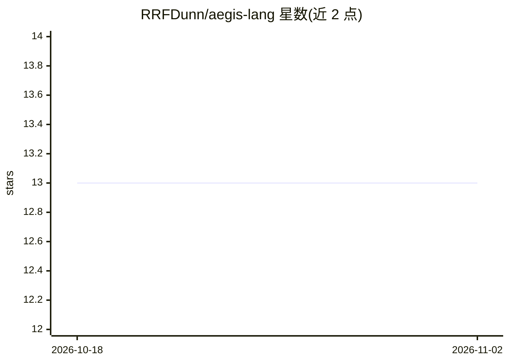

# RRFDunn/aegis-lang

⭐ 13 · Python · Apache-2.0 · 推送 2026-03-07 · [GitHub](https://github.com/RRFDunn/aegis-lang) · [官网](https://github.com/RRFDunn/aegis-lang#readme) · 个人维护

**面向 AI agent 的安全优先编程语言，转译为带运行时防护的 Python**

Aegis 是一门 security-by-construction 的 DSL，将 .aegis 文件转译为 Python，在语言层面内置污点追踪、能力限制（@capabilities）、契约校验（Z3 形式化验证）、哈希链审计日志与沙箱（封禁 eval/exec/__import__），零运行时依赖，仅需 Python 3.11+ 标准库。提供 20+ CLI 命令（run/check/compile/audit/compliance/lsp/serve 等）、EU AI Act（Articles 9-15）合规分析工具、7 个示例 agent 应用与 VS Code 扩展。面向需要构建安全可审计 AI agent 的开发者。

## 筛选速览

| 维度 | 判定 | 备注 |
|---|---|---|
| AI 角色 | `ai-ecosystem` | LLM/agent 周边工具 |
| 许可风险 | `permissive` | Apache-2.0 |
| 部署形态 | `library` | 以包/库形式分发 |
| 模型依赖 | — | README 未给出锁定关系 |
| 硬件要求 | — | 无带数字的原话,不猜 |
| 安装摩擦 | `low` | 无编译、无系统依赖或容器化 |
| 成熟度 | — | 结构信号不足 |

## 能力要点

- 污点追踪、能力限制、契约、审计、沙箱内建于语言并运行时强制
- Z3 SMT 求解器对契约做形式化验证（aegis verify-contracts）
- EU AI Act 合规差距分析（@risk_level 触发自动审计注入，Articles 9-15）
- A2A HTTP 端点发布、Agent Card 生成、LSP 服务器与 VS Code 扩展

## 适用场景

- 开发对输入污点与权限边界有强制要求的 AI agent
- 生成满足 EU AI Act 审计要求、可验证审计链的合规 agent
- 对 agent 的 sanitizer 与能力边界做形式化验证与模糊测试

## 场景标签

`网络安全` · 领域:学习与行业

## 证据(README 行号)

> L7: A security-by-construction programming language for AI agents. Aegis transpiles `.aegis` files to Python with **runt
> L64: Aegis has first-class constructs for building safe AI agents:

## 星数曲线

2026-10-18 13 → 2026-11-02 13（+0）

---
*卡片 v1 · prompt 1.4 · 生成 2026-10-31 · 置信度 mid · 依据 README sha `01e154937e1c` · [字段定义](../../DATASET.md)*
