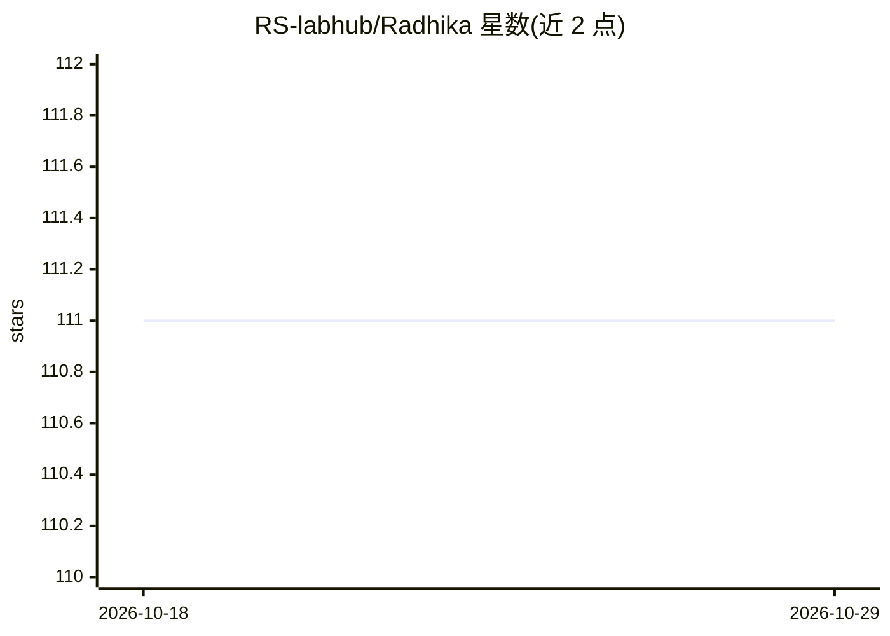

# RS-labhub/Radhika

⭐ 111 · TypeScript · MIT · 推送 2026-10-04 · [GitHub](https://github.com/RS-labhub/Radhika) · [官网](https://radhika.rohansrma.me) · 个人维护

**多模型多模式的个人 AI 聊天助手（网页应用）**

基于 Next.js 构建的 AI 助手应用，提供 General、Productivity、Wellness、Learning、Creative、BFF 六种聊天模式，接入 Groq、Gemini、OpenAI、Claude 多个 LLM 提供商，并支持 Pollinations、DALL·E 3、Hugging Face 等图像生成与语音输入输出。使用 Supabase 做认证、聊天历史与收藏持久化，界面支持亮/暗主题与像素风格。通过 git clone 加 bun/npm 本地运行，提供 Vercel 在线试用地址。

## 筛选速览

| 维度 | 判定 | 备注 |
|---|---|---|
| AI 角色 | `ai-native` | 本体是模型或模型工具 |
| 许可风险 | `permissive` | MIT |
| 部署形态 | `library` | 以包/库形式分发 |
| 模型依赖 | locked-api |  |
| 硬件要求 | — | 无带数字的原话,不猜 |
| 安装摩擦 | `low` | 无编译、无系统依赖或容器化 |
| 成熟度 | — | 结构信号不足 |

## 能力要点

- 6 种聊天模式（General/Productivity/Wellness/Learning/Creative/BFF）
- 多 LLM 提供商接入：Groq、Gemini、OpenAI、Claude
- 图像生成（Pollinations/DALL·E 3/Hugging Face）与语音输入输出
- Supabase 认证与聊天历史、收藏持久化

## 适用场景

- 按场景切换模式进行日常对话、学习或创作辅助
- 在同一界面使用不同 LLM 提供商与图像生成
- 保存聊天历史与收藏对话内容

## 场景标签

`AI 助手` `聊天机器人` `图像生成` · 领域:对话与助手

## 证据(README 行号)

> L5: A modern AI assistant that adapts to how you work and think. Multiple modes, multiple models, one seamless chat expe
> L19: - **Multi-Provider LLM**: Groq, Gemini, OpenAI, Claude

## 星数曲线

2026-10-18 111 → 2026-10-29 111（+0）

---
*卡片 v1 · prompt 1.4 · 生成 2026-10-23 · 置信度 high · 依据 README sha `0ac8ac26617b` · [字段定义](../../DATASET.md)*
