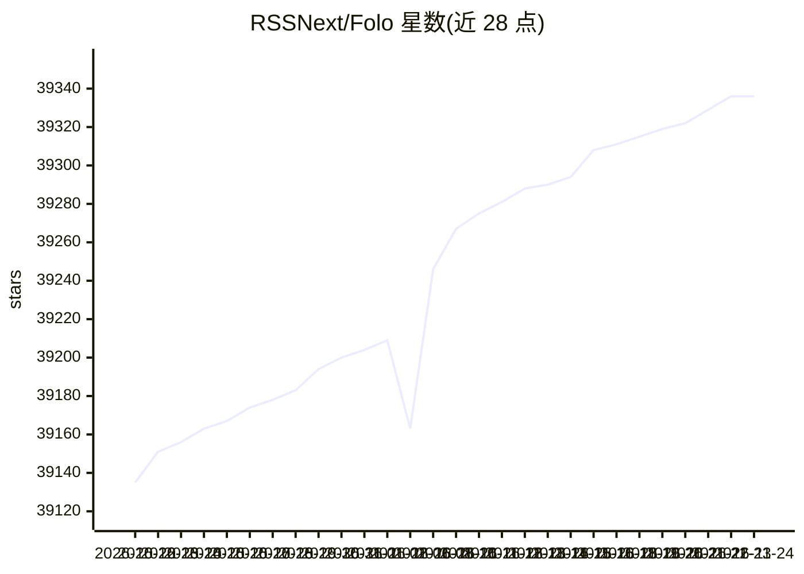

# RSSNext/Folo

⭐ 39,341 · TypeScript · AGPL-3.0 · 推送 2026-11-23 · [GitHub](https://github.com/RSSNext/Folo) · [官网](https://app.folo.is) · 组织维护

**面向读者的 AI RSS 阅读器：聚合订阅并提供摘要与翻译**

开源 RSS 阅读器，将博客、新闻、newsletter、播客、视频与社交源聚合到同一时间线。AI 功能包括：对文章/订阅源提问（可自带 API key、接入 MCP 服务）、时间线摘要、四语种翻译、按需或自动文章摘要、定时生成日报/周报并投递到聊天或邮箱。支持 Web 与 iOS/Android/macOS/Windows/Linux 客户端并同步订阅状态；可订阅 RSS/Atom/JSON 及 RSSHub 路由，支持 OPML 导入导出、多种第三方集成与 TTS 朗读。

## 筛选速览

| 维度 | 判定 | 备注 |
|---|---|---|
| AI 角色 | `ai-enhanced` | 去掉 AI 部分产品仍成立 |
| 许可风险 | `viral` | AGPL-3.0 |
| 部署形态 | `None` |  |
| 模型依赖 | — | README 未给出锁定关系 |
| 硬件要求 | — | 无带数字的原话,不猜 |
| 安装摩擦 | `low` | 无编译、无系统依赖或容器化 |
| 成熟度 | — | 结构信号不足 |

## 能力要点

- 对文章、订阅源、文件夹提问，可自带 API key 并接入 MCP 服务
- 时间线摘要与文章级 AI 翻译（英/中/日/法）和摘要
- 定时 AI 任务生成日报/周报并投递到聊天或邮箱
- 订阅 RSS/Atom/JSON 及数千条 RSSHub 路由，支持 OPML 导入导出

## 适用场景

- 把博客、播客、视频和社交源聚合到一个阅读时间线
- 用 AI 摘要和翻译处理大量未读文章
- 每天定时收到自动生成的订阅内容简报

## 场景标签

`语音合成` `文档问答` · 领域:内容生成

## 证据(README 行号)

> L13: Folo is an open-source AI RSS reader that brings everything you follow into one calm timeline, then helps you read 
> L17: Folo runs in the browser and on iOS, Android, macOS, Windows and Linux, and keeps your subscriptions, read status a
> L56: Ask about an article, a feed, a folder or everything you follow. Pick your AI model or bring your own API key, and 

## 星数曲线

2026-10-22 39,135 → 2026-11-24 39,336（+201）

---
*卡片 v1 · prompt 1.4 · 生成 2026-11-22 · 置信度 high · 依据 README sha `f99fe6e93b84` · [字段定义](../../DATASET.md)*
