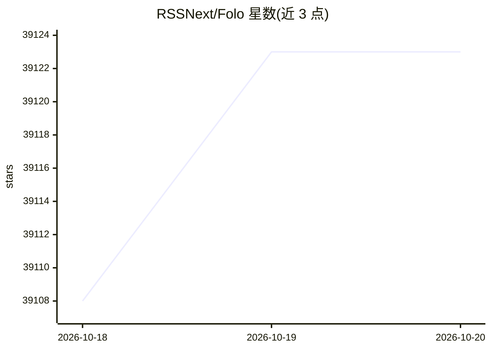

# RSSNext/Folo

⭐ 39,123 · TypeScript · AGPL-3.0 · 推送 2026-10-19 · [GitHub](https://github.com/RSSNext/Folo) · [官网](https://app.folo.is) · 组织维护

**开源 AI RSS 阅读器，聚合订阅源并提供摘要问答**

面向普通读者的跨平台 RSS 阅读器：订阅博客、新闻、通讯、播客、视频频道与社交信息流，聚合成统一时间线，并在多设备间同步。AI 功能包括对文章/订阅源提问、时间线每日摘要、AI 翻译与文章摘要、定时生成日报周报的 AI 任务，可选模型或自带 API key，并支持连接 MCP 服务。另含 OPML 导入导出、RSSHub 路由订阅、文本转语音与第三方工具集成。提供 Web/iOS/Android/macOS/Windows/Linux 客户端，AGPL-3.0 许可。

## 筛选速览

| 维度 | 判定 | 备注 |
|---|---|---|
| AI 角色 | `ai-enhanced` | 去掉 AI 部分产品仍成立 |
| 许可风险 | `viral` | AGPL-3.0 |
| 部署形态 | `None` |  |
| 模型依赖 | — | README 未给出锁定关系 |
| 硬件要求 | — | 无带数字的原话,不猜 |
| 安装摩擦 | `low` | 无编译、无系统依赖或容器化 |
| 成熟度 | `idea` | |

## 能力要点

- 跨平台客户端（Web/iOS/Android/macOS/Windows/Linux）与多设备同步
- AI 问答、时间线摘要与多语言翻译（英/中/日/法）
- AI Tasks 定时生成日报/周报并投递到聊天或邮件
- 支持 RSSHub 路由、OPML 导入导出与 Obsidian/Readwise 等集成

## 适用场景

- 把博客、新闻、播客、社媒订阅集中到一个时间线阅读
- 让 AI 生成每日摘要或翻译外文文章
- 用自然语言向订阅内容提问

## 场景标签

`文档问答` · 领域:知识与检索

## 证据(README 行号)

> L13: Folo is an open-source AI RSS reader that brings everything you follow into one calm timeline, then helps you read 
> L56: Ask about an article, a feed, a folder or everything you follow. Pick your AI model or bring your own API key, and 

## 星数曲线

2026-10-18 39,108 → 2026-10-20 39,123（+15）

---
*卡片 v1 · prompt 1.4 · 生成 2026-10-20 · 置信度 high · 依据 README sha `02aceb9115e0` · [字段定义](../../DATASET.md)*
