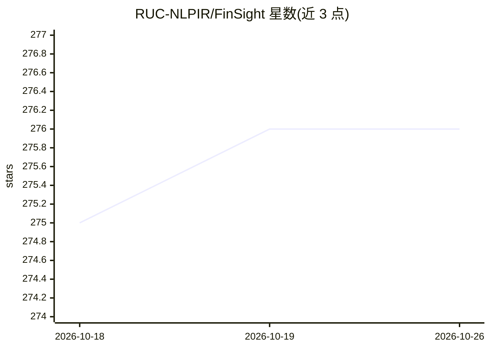

# RUC-NLPIR/FinSight

⭐ 276 · Jupyter Notebook · GPL-3.0 · 推送 2026-04-06 · [GitHub](https://github.com/RUC-NLPIR/FinSight) · 组织维护 · 中文 README

**输入股票代码即自动产出金融深度研究报告的多智能体系统**

面向金融研究的自动化深度研究系统：多智能体流水线（数据采集→分析→报告撰写→渲染），输入公司名或股票代码后自动采集 A股/港股/美股行情、财报与宏观指标数据，经 Code Agent 执行 Python 分析与 VLM 反馈的图表修正，产出带引用溯源的 2 万字级报告（MD/DOCX/PDF）。需自备 LLM/VLM/搜索 API key，Python 3.10+，可选 Pandoc 与 Node.js Web UI。由高校实验室（人大 NLPIR）维护，自称仍在开发中。

## 筛选速览

| 维度 | 判定 | 备注 |
|---|---|---|
| AI 角色 | `ai-native` | 本体是模型或模型工具 |
| 许可风险 | `viral` | GPL-3.0 |
| 部署形态 | `library` | 以包/库形式分发 |
| 模型依赖 | — | README 未给出锁定关系 |
| 硬件要求 | — | 无带数字的原话,不猜 |
| 安装摩擦 | `low` | 无编译、无系统依赖或容器化 |
| 成熟度 | `idea` | |

## 能力要点

- 多智能体流水线：采集→分析→撰写→渲染，支持检查点断点续跑
- CAVM 可编程 Code Agent 在统一变量空间执行 Python 代码
- VLM 反馈循环自动修正图表（图例/刻度/信息密度）
- 覆盖 A股/港股/美股行情、财报与中美宏观指标（yfinance/FRED）

## 适用场景

- 输入一个 ticker 生成上市公司深度研究报告
- 自动化行业或宏观经济分析并输出可发布文档
- 基于引用溯源核验报告结论的数据来源

## 场景标签

`多智能体` `金融量化` `RAG` · 领域:Agent 开发

## 证据(README 行号)

> L12: **FinSight** is a multi-agent research system that automates the entire financial research process — from data coll
> L35: * **📊 Professional-Grade Report Generation**

## 星数曲线

2026-10-18 275 → 2026-10-26 276（+1）

---
*卡片 v1 · prompt 1.4 · 生成 2026-10-22 · 置信度 mid · 依据 README sha `1df673abca14` · [字段定义](../../DATASET.md)*
