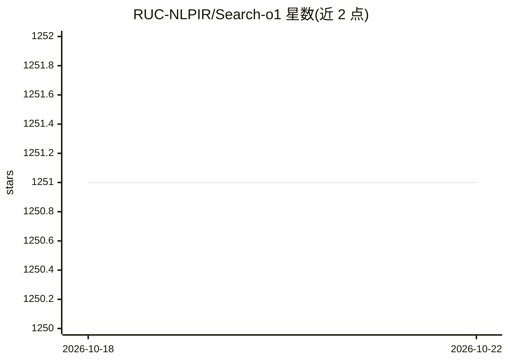

# RUC-NLPIR/Search-o1

⭐ 1,251 · Python · MIT · 推送 2025-11-17 · [GitHub](https://github.com/RUC-NLPIR/Search-o1) · 组织维护 · 中文 README

**为大型推理模型增加 agentic 检索增强的开源框架**

中国人民大学 NLPIIR 团队提出的科研框架（EMNLP 2025 主会论文）：通过 Agentic Search Workflow 让大型推理模型在推理中遇到不确定信息时动态触发 Bing 搜索检索外部知识，并用 Reason-in-Documents 模块精炼检索文档后整合回推理链。支持批量生成与交错检索，提供 GPQA、MATH500、AIME、LiveCodeBench 等 10 个基准的预处理与推理脚本（直接生成/朴素 RAG/agentic 检索/Search-o1 四种模式），依赖本地模型路径与 Bing、Jina API key。以 Python 3.9+ conda 环境从源码运行，MIT 许可。

## 筛选速览

| 维度 | 判定 | 备注 |
|---|---|---|
| AI 角色 | `ai-ecosystem` | LLM/agent 周边工具 |
| 许可风险 | `permissive` | MIT |
| 部署形态 | `None` |  |
| 模型依赖 | — | README 未给出锁定关系 |
| 硬件要求 | — | 无带数字的原话,不猜 |
| 安装摩擦 | `low` | 无编译、无系统依赖或容器化 |
| 成熟度 | — | 结构信号不足 |

## 能力要点

- Agentic Search：模型在推理中自主触发外部检索
- Reason-in-Documents 模块精炼并整合检索文档
- 批量生成与交错检索的推理机制
- 覆盖 10 个推理/问答基准的数据预处理与四种推理模式脚本

## 适用场景

- 在数学、代码、博士级科学问答等推理基准上评测检索增强效果
- 为自有大型推理模型接入 agentic 搜索能力
- 复现论文实验或开展 RAG 与推理结合的研究

## 场景标签

`RAG` `模型评测` `科研工具` · 领域:评测与运维

## 证据(README 行号)

> L30: To overcome these challenges, we present **Search-o1**, a framework that augments LRMs with an **agentic Retrieval-
> L31: - **Agentic Search Workflow**: Integrates an agentic search process into the reasoning workflow, allowing models it
> L32: - **Reason-in-Documents Module**: Seamlessly integrates the retrieved information, reducing noise and maintaining a

## 星数曲线

2026-10-18 1,251 → 2026-10-22 1,251（+0）

---
*卡片 v1 · prompt 1.4 · 生成 2026-10-21 · 置信度 high · 依据 README sha `f092caf2d448` · [字段定义](../../DATASET.md)*
