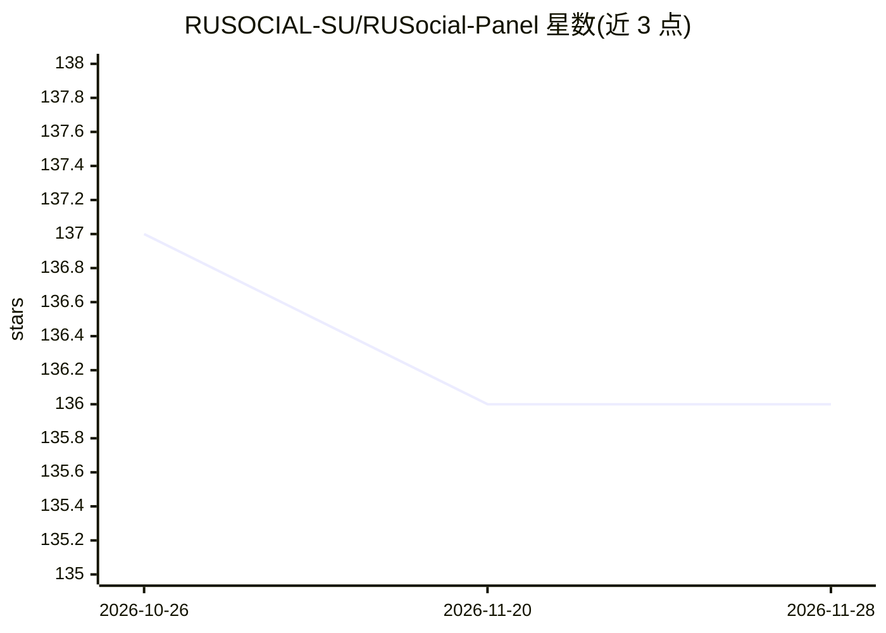

# RUSOCIAL-SU/RUSocial-Panel

⭐ 136 · 推送 2026-11-20 · [GitHub](https://github.com/RUSOCIAL-SU/RUSocial-Panel) · [官网](https://panel.rusocial.io) · 组织维护

**面向 OFM/Fame 运营团队的社媒管理面板**

RUSocial 的 OFM / Fame Panel 产品，README 仅提供 Discord 邀请链接与面板入口地址，以及两段演示视频附件；README 未说明具体功能模块、安装方式或运行要求。从主题标签看，项目围绕 OnlyFans/OFM 运营场景，涉及 Instagram、Snapchat、Telegram 等平台及 Snapchat API/ATT token 相关内容。功能细节与 AI 能力需进入其 Discord 或面板页面确认。

## 筛选速览

| 维度 | 判定 | 备注 |
|---|---|---|
| AI 角色 | `ai-enhanced` | 去掉 AI 部分产品仍成立 |
| 许可风险 | `none` | — |
| 部署形态 | `None` |  |
| 模型依赖 | — | README 未给出锁定关系 |
| 硬件要求 | — | 无带数字的原话,不猜 |
| 安装摩擦 | `low` | 无编译、无系统依赖或容器化 |
| 成熟度 | — | 结构信号不足 |

## 能力要点

- 提供在线面板入口（panel.rusocial.io）
- 官方 Discord 邀请渠道
- 主题标签覆盖 OFM/onlyfans 及多社媒平台

## 适用场景

- 加入官方 Discord 获取产品信息
- 访问在线面板进行 OFM 运营管理

## 场景标签

 · 领域:社媒运营工具

## 证据(README 行号)

> L3: Official Invite: https://discord.gg/rusocial
> L4: Panel: https://panel.rusocial.io

## 星数曲线

2026-10-26 137 → 2026-11-28 136（-1）

---
*卡片 v1 · prompt 1.4 · 生成 2026-11-28 · 置信度 low · 依据 README sha `a692e04c92e0` · [字段定义](../../DATASET.md)*
