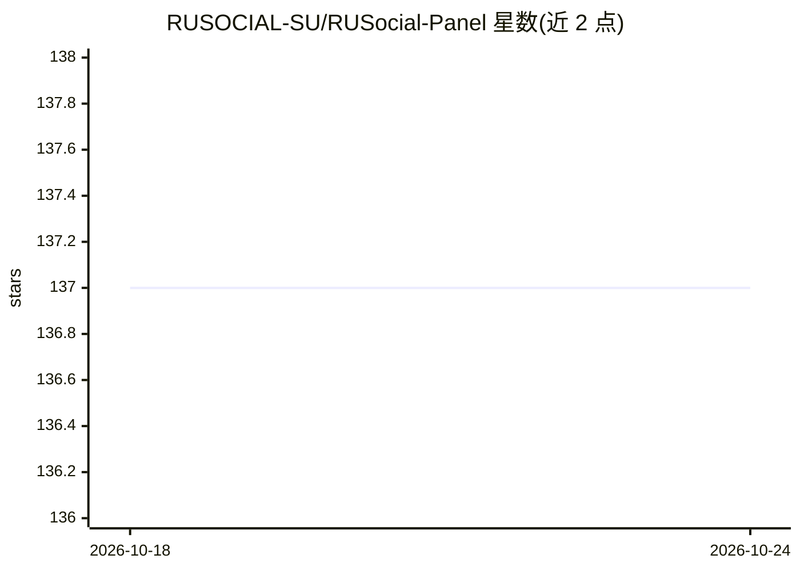

# RUSOCIAL-SU/RUSocial-Panel

⭐ 137 · 推送 2026-08-29 · [GitHub](https://github.com/RUSOCIAL-SU/RUSocial-Panel) · [官网](https://panel.rusocial.io) · 组织维护

**RUSocial 面板项目：提供在线 Panel 与 Discord 社区入口**

README 仅包含 Discord 邀请链接、在线面板地址（panel.rusocial.io）与两个视频附件链接，未描述功能、安装方式或使用方法。仓库主题标签涉及 Instagram、Snapchat、Telegram、OFM 等，但正文无可验证的功能说明。无法从 README 确认其 AI 能力形态与目标用户，仅可确认存在一个托管面板与社区渠道。

## 筛选速览

| 维度 | 判定 | 备注 |
|---|---|---|
| AI 角色 | `ai-ecosystem` | LLM/agent 周边工具 |
| 许可风险 | `none` | — |
| 部署形态 | `None` |  |
| 模型依赖 | — | README 未给出锁定关系 |
| 硬件要求 | — | 无带数字的原话,不猜 |
| 安装摩擦 | `low` | 无编译、无系统依赖或容器化 |
| 成熟度 | — | 结构信号不足 |

## 能力要点

- 提供在线面板地址 panel.rusocial.io
- 提供 Discord 社区邀请链接
- README 附两个视频附件

## 适用场景

- 通过 panel.rusocial.io 访问在线面板
- 通过 Discord 链接加入社区

## 场景标签

 · 领域:社交媒体工具

## 证据(README 行号)

> L3: Official Invite: https://discord.gg/rusocial
> L4: Panel: https://panel.rusocial.io

## 星数曲线

2026-10-18 137 → 2026-10-24 137（+0）

---
*卡片 v1 · prompt 1.4 · 生成 2026-10-22 · 置信度 low · 依据 README sha `3c09cd71a7a8` · [字段定义](../../DATASET.md)*
