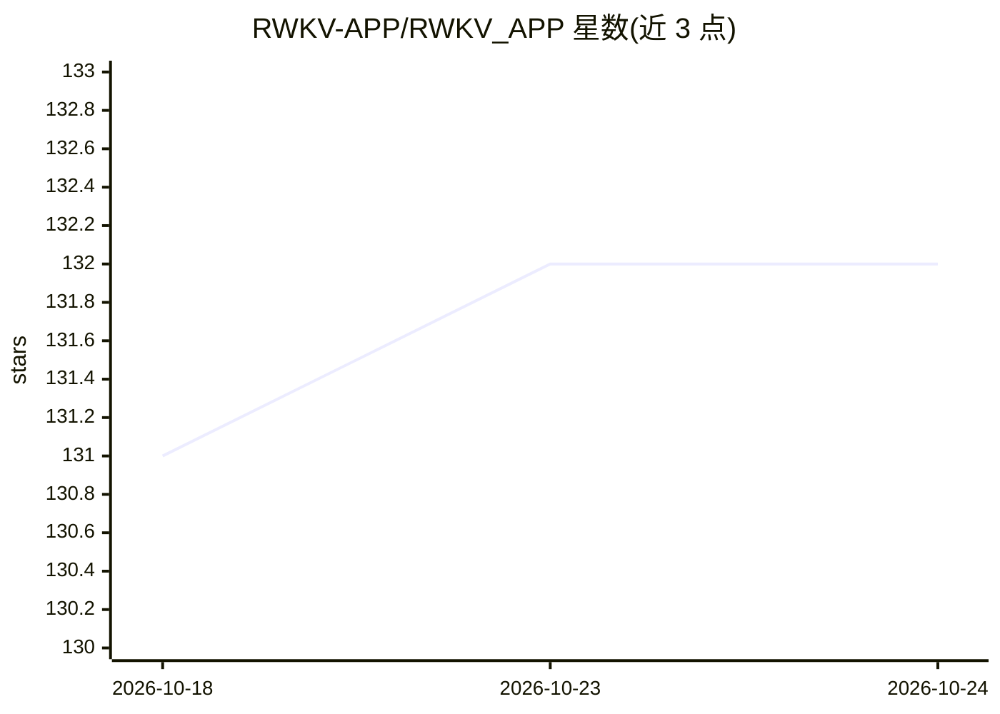

# RWKV-APP/RWKV_APP

⭐ 132 · Dart · Apache-2.0 · 推送 2026-10-23 · [GitHub](https://github.com/RWKV-APP/RWKV_APP) · [官网](https://rwkv.halowang.cloud) · 组织维护 · 中文 README

**跨平台本地 RWKV 聊天应用：手机/桌面端离线推理**

基于 Flutter 构建的隐私优先端侧 AI 应用，覆盖 Android、iOS、Windows、macOS 与 Linux。用户可从 Hugging Face 下载 RWKV 模型到本地，加载后推理在设备上完成，支持多轮对话、文本转语音、图像理解，并可在桌面端暴露 OpenAI 兼容的本地 API 端点。底层为 C++ 推理引擎，通过 Dart FFI 通信，支持 CPU/GPU/NPU 加速。README 声明为实验性早期版本，旧设备（如 iPhone 14 之前）可能无法流畅运行 1.5B/2.9B 参数模型。

## 筛选速览

| 维度 | 判定 | 备注 |
|---|---|---|
| AI 角色 | `ai-native` | 本体是模型或模型工具 |
| 许可风险 | `permissive` | Apache-2.0 |
| 部署形态 | `None` |  |
| 模型依赖 | — | README 未给出锁定关系 |
| 硬件要求 | — | 无带数字的原话,不猜 |
| 安装摩擦 | `low` | 无编译、无系统依赖或容器化 |
| 成熟度 | `idea` | |

## 能力要点

- 五端跨平台（Android/iOS/Windows/macOS/Linux）本地推理
- 多工作流：聊天、TTS、视觉理解集成于一
- 从 Hugging Face 下载并切换模型进行对比
- 桌面端可选暴露 OpenAI 兼容本地 API 端点

## 适用场景

- 在手机或桌面离线运行 RWKV 模型聊天，不上传数据
- 在真实硬件上对比不同本地模型的质量与速度
- 通过本地 OpenAI 兼容端点接入其他工具做实验

## 场景标签

`聊天机器人` `语音合成` `多模态` · 领域:对话与助手

## 证据(README 行号)

> L10: **Run private, on-device AI on phones and desktops with RWKV App.**
> L13: RWKV App is a privacy-first AI app for Android, iOS, Windows, macOS, and Linux. It lets you download local models, 
> L29: - **🔊 Text-to-Speech (TTS):** Convert text into natural-sounding speech.

## 星数曲线

2026-10-18 131 → 2026-10-24 132（+1）

---
*卡片 v1 · prompt 1.4 · 生成 2026-10-23 · 置信度 high · 依据 README sha `f74f13f3d832` · [字段定义](../../DATASET.md)*
