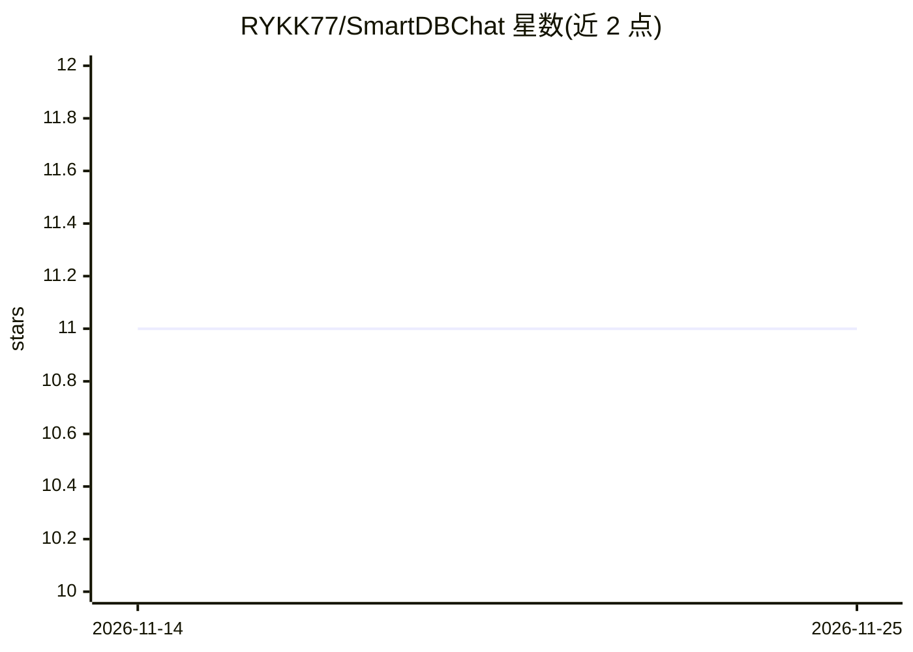

# RYKK77/SmartDBChat

⭐ 11 · Python · MIT · 推送 2026-11-19 · [GitHub](https://github.com/RYKK77/SmartDBChat) · 个人维护 · 中文 README

**自然语言查数据库的 NL2SQL 工作台，带 MCP 服务与 RBAC**

基于 FastAPI + React 19 前后端分离的自然语言数据库查询与分析工作台：用户以自然语言提问，系统构建表-列-外键 SchemaGraph 做图谱 Schema Linking，生成经 sqlglot AST 校验的只读 SQL，包含有界纠错重试、语义预检、多数投票高精度模式，并流式输出解读与交互式图表。内置多用户 RBAC、SQLite 服务端持久化、语义层（YAML/可视化配置）与 MCP 服务中心，可生成 Claude Desktop/Cursor 等客户端的接入配置。基于 OpenAI 兼容协议接入多家服务商，亦支持本地 Ollama；依赖 Python 3.10+、uv、Node.js 20+，数据库支持 MySQL 或内置 SQLite 演示沙箱。

## 筛选速览

| 维度 | 判定 | 备注 |
|---|---|---|
| AI 角色 | `ai-native` | 本体是模型或模型工具 |
| 许可风险 | `permissive` | MIT |
| 部署形态 | `library` | 以包/库形式分发 |
| 模型依赖 | local-ok | 支持本地模型 |
| 硬件要求 | — | 无带数字的原话,不猜 |
| 安装摩擦 | `low` | 无编译、无系统依赖或容器化 |
| 成熟度 | — | 结构信号不足 |

## 能力要点

- 图谱 Schema Linking 自动发现跨表最短 JOIN 路径与桥接表
- sqlglot AST 只读护栏拦截写操作、注入与高危函数
- 内置标准 MCP Server（STDIO/SSE/Streamable HTTP）暴露六大工具
- 语义缓存的嵌入服务支持 OpenAI 与 Ollama 两种协议

## 适用场景

- 让业务人员用自然语言查询 MySQL 数据并生成图表
- 把数据库查询能力通过 MCP 接入 Claude Desktop/Cursor 等客户端
- 团队按 admin/editor/viewer 角色分级管理数据源与查询权限

## 场景标签

`数据分析` · 领域:效率与自动化

## 证据(README 行号)

> L3: SmartDBChat 是一个基于大语言模型（LLM）的自然语言数据库查询与分析工作台（NL2SQL + BI + MCP）。用户无需编写 SQL，只需用自然语言提问，系统即可自动完成图谱 Schema Linking、生成受 AS
> L13: - **MCP 服务中心与开放集成**：内置标准 MCP Server（支持 `STDIO`、`SSE` 与 `Streamable HTTP` 传输协议），对外暴露 `list_tables`、`get_database_sch

## 星数曲线

2026-11-14 11 → 2026-11-25 11（+0）

---
*卡片 v1 · prompt 1.4 · 生成 2026-11-18 · 置信度 high · 依据 README sha `f957e4aba452` · [字段定义](../../DATASET.md)*
