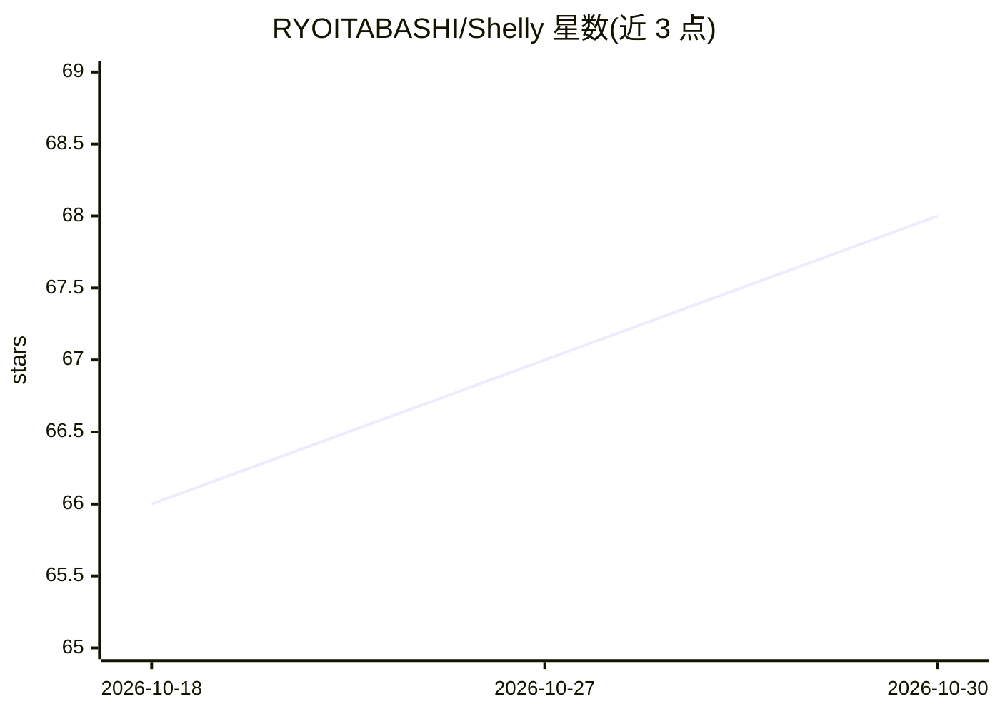

# RYOITABASHI/Shelly

⭐ 68 · TypeScript · GPL-3.0 · 推送 2026-10-29 · [GitHub](https://github.com/RYOITABASHI/Shelly) · 个人维护

**Android 手机上的 AI 终端 IDE 与无人值守 agent 运行时**

面向开发者的开源 Android 应用：在手机上提供原生终端 IDE（自有 JNI PTY、APK 内捆绑 bash/git/Python/Node.js 等工具与 Codex CLI），AI 面板与终端并排，可读取终端输出、一键执行修复命令；支持注册自然语言定时 agent，闹钟唤醒在设备上用用户自己的 AI 账号与本地 LLM 运行；可通过 `shelly codex pair` 与 ChatGPT (Codex) 配对，由 ChatGPT 驱动手机操作且每次需用户在手机上批准。以 GitHub Releases APK 分发（约 800 MB），应用内自更新并校验 SHA-256。README 明确标注完整无人值守循环仅在 Galaxy Z Fold6 上端到端验证过一次（N=1）。

## 筛选速览

| 维度 | 判定 | 备注 |
|---|---|---|
| AI 角色 | `ai-native` | 本体是模型或模型工具 |
| 许可风险 | `viral` | GPL-3.0 |
| 部署形态 | `library` | 以包/库形式分发 |
| 模型依赖 | local-ok | 支持本地模型 |
| 硬件要求 | — | 无带数字的原话,不猜 |
| 安装摩擦 | `low` | 无编译、无系统依赖或容器化 |
| 成熟度 | `idea` | |

## 能力要点

- 应用自有 JNI PTY 原生终端，APK 内捆绑 bash/git/Python/Node 与 Codex CLI，不用 Termux
- 终端 + AI 双面板：AI 读取终端输出并生成可一键执行的修复命令
- 自然语言注册定时 agent，闹钟唤醒、屏幕关闭下在设备上运行
- 通过 `shelly codex pair` 由 ChatGPT 驱动手机操作，每个动作需用户在手机上批准

## 适用场景

- 在没有 PC 的情况下在 Android 手机上运行真实终端与 AI 编程 CLI
- 让 AI 读取终端报错并直接给出可执行的修复命令，省去复制粘贴
- 注册每日定时 agent，自动抓取资料、用本地 LLM 总结并写入带引用的笔记
- 通过 ChatGPT 远程驱动手机上的应用任务，并逐次审批

## 场景标签

`编码 Agent` · 领域:编码与开发

## 证据(README 行号)

> L7:  Let ChatGPT use your Android phone — and approve every move yourself.
> L29:  Shelly also wakes on its own alarm — screen off — and runs scheduled agents with your own AI accounts, local LLMs 
> L108: - **The agent layer** — say what you want in plain language; Shelly registers a scheduled agent that wakes on an A

## 星数曲线

2026-10-18 66 → 2026-10-30 68（+2）

---
*卡片 v1 · prompt 1.4 · 生成 2026-10-24 · 置信度 high · 依据 README sha `d37657705763` · [字段定义](../../DATASET.md)*
