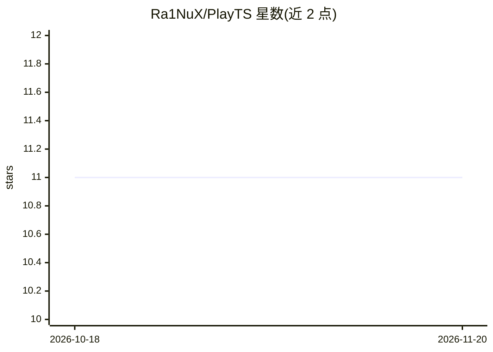

# Ra1NuX/PlayTS

⭐ 11 · TypeScript · NOASSERTION · 推送 2026-03-19 · [GitHub](https://github.com/Ra1NuX/PlayTS) · [官网](https://app.playts.net) · 个人维护

**开发者的桌面端 TypeScript 代码运行与转译沙盒**

基于 React 与 Electron 构建的桌面代码演练场，在 Windows/macOS/Linux 原生运行。通过 WebContainers 提供隔离的代码执行环境，支持代码转译、实时测试，并内置书签系统（含全局书签）与 WebContainer 内的 npm 包安装管理，包可跨会话保留。提供英文/西班牙文界面。提供各平台安装包下载；因无付费证书，Windows/macOS 会出现不受信任提示。许可为个人使用许可，禁止商业使用与再分发。

## 筛选速览

| 维度 | 判定 | 备注 |
|---|---|---|
| AI 角色 | `ai-enhanced` | 去掉 AI 部分产品仍成立 |
| 许可风险 | `none` | NOASSERTION |
| 部署形态 | `library` | 以包/库形式分发 |
| 模型依赖 | — | README 未给出锁定关系 |
| 硬件要求 | — | 无带数字的原话,不猜 |
| 安装摩擦 | `low` | 无编译、无系统依赖或容器化 |
| 成熟度 | — | 结构信号不足 |

## 能力要点

- WebContainers 隔离执行与代码转译
- 书签系统支持标签组织与全局书签
- WebContainer 环境内直接安装与管理 npm 包
- Windows/macOS/Linux 三平台桌面应用

## 适用场景

- 快速运行和测试 TypeScript/JavaScript 函数片段
- 把常用代码函数存为书签并在不同执行间复用
- 在隔离环境里安装 npm 依赖做实验

## 场景标签

 · 领域:开发者工具/代码执行环境

## 证据(README 行号)

> L18: Developed using React and Electron, PlayTS offers a modern and intuitive interface while running natively on Window
> L26: - **Secure Execution:** Utilizes WebContainers to safely isolate code execution.

## 星数曲线

2026-10-18 11 → 2026-11-20 11（+0）

---
*卡片 v1 · prompt 1.4 · 生成 2026-11-18 · 置信度 mid · 依据 README sha `dca11108d677` · [字段定义](../../DATASET.md)*
