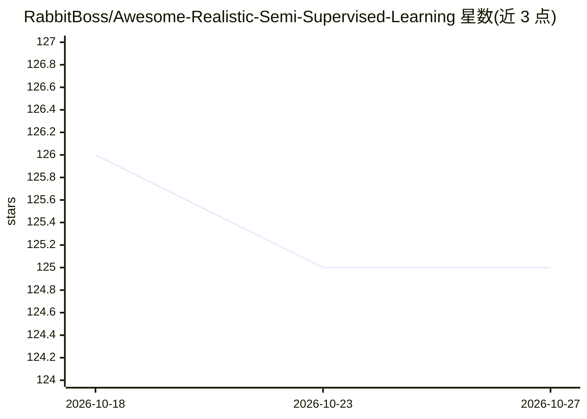

# RabbitBoss/Awesome-Realistic-Semi-Supervised-Learning

⭐ 125 · Shell · 推送 2026-06-04 · [GitHub](https://github.com/RabbitBoss/Awesome-Realistic-Semi-Supervised-Learning) · 个人维护

**面向真实场景的半监督学习论文清单（类别不平衡/开集/开放世界）**

半监督学习（SSL）在真实设定下的论文聚合清单，按 Open-Set SSL、Open-World SSL、Class-Imbalanced SSL、Novel Class Discovery 四个方向组织，条目以会议/期刊名与年份标注，多数附带论文链接，部分附带代码链接，收录时间跨度为 2018 年至 2026 年。维护者声明将定期更新清单，并提供联系邮箱接收增补请求。面向从事半监督学习研究的科研人员，用于文献检索与跟进。

## 筛选速览

| 维度 | 判定 | 备注 |
|---|---|---|
| AI 角色 | `ai-knowledge` | 知识聚合/清单类 |
| 许可风险 | `none` | — |
| 部署形态 | `None` |  |
| 模型依赖 | — | README 未给出锁定关系 |
| 硬件要求 | — | 无带数字的原话,不猜 |
| 安装摩擦 | `low` | 无编译、无系统依赖或容器化 |
| 成熟度 | — | 结构信号不足 |

## 能力要点

- 覆盖 Open-Set/Open-World/Class-Imbalanced SSL 与 Novel Class Discovery 四个方向的论文条目
- 条目按发表会议/期刊与年份标注，多数附论文链接、部分附代码链接
- 维护者声明定期更新并接受增补请求

## 适用场景

- 查找类别不平衡或开集设定下的半监督学习论文
- 跟进 2018-2026 年真实场景 SSL 研究方向的进展
- 为相关研究寻找附带代码实现的工作

## 场景标签

`精选清单` `科研工具` · 领域:学习与行业

## 证据(README 行号)

> L2: An awesome paper list of **Semi-Supervised Learning (SSL)** under realistic (Class-Imbalanced & Open-Set & Open-Worl
> L7: ## Open-Set SSL

## 星数曲线

2026-10-18 126 → 2026-10-27 125（-1）

---
*卡片 v1 · prompt 1.4 · 生成 2026-10-23 · 置信度 high · 依据 README sha `ccabd179fa2e` · [字段定义](../../DATASET.md)*
