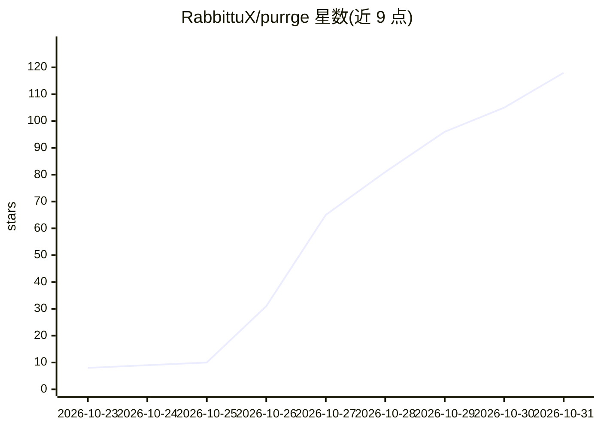

# RabbittuX/purrge

⭐ 118 · Python · NOASSERTION · 推送 2026-10-29 · [GitHub](https://github.com/RabbittuX/purrge) · 个人维护 · 中文 README

**macOS/Windows 的 AI 辅助磁盘清理工具：低空间预警+AI 分析+用户确认**

macOS 与 Windows 的磁盘空间管理工具：后台服务定时检测剩余空间，低于阈值（默认 15 GB）时提醒，用户同意后扫描本机缓存、大文件与历史项目，调用本机的 Claude Code、Codex、WorkBuddy 或 DeepSeek Harness 逐项分析用途与清理影响；分析结果分为首要清理、需用户决定、不会清理三类，仅执行用户勾选确认的项目，AI 在禁用工具/只读沙箱模式运行、不具备删除权限。通过 Homebrew、安装脚本或 PowerShell Gallery 安装，采用 PolyForm Noncommercial 许可证，禁止商业使用。

## 筛选速览

| 维度 | 判定 | 备注 |
|---|---|---|
| AI 角色 | `ai-enhanced` | 去掉 AI 部分产品仍成立 |
| 许可风险 | `none` | NOASSERTION |
| 部署形态 | `None` |  |
| 模型依赖 | — | README 未给出锁定关系 |
| 硬件要求 | — | 无带数字的原话,不猜 |
| 安装摩擦 | `low` | 无编译、无系统依赖或容器化 |
| 成熟度 | — | 结构信号不足 |

## 能力要点

- 后台低空间预警不调用 AI，阈值/频率/静默时长可配置
- AI 逐项分析（Claude Code/Codex/WorkBuddy/DeepSeek Harness），四种引擎可随时切换
- AI 仅提供建议、无删除权限，删除严格按用户勾选清单执行，清理文件进废纸篓/回收站
- 保护名单优先于 AI 判断，审查页面仅监听 127.0.0.1 并使用一次性令牌

## 适用场景

- 磁盘快满时让 AI 帮我逐项判断哪些缓存和文件能清
- 磁盘剩余空间低于阈值时收到系统提醒再决定是否清理
- 在 Claude Code / Codex 里说一句话就触发扫描与清理审查

## 场景标签

 · 领域:系统工具/磁盘清理

## 证据(README 行号)

> L5: **基于 AI 的磁盘空间管理工具（macOS / Windows）：低空间预警、智能识别可清理项、经用户审批后执行清理。**
> L35: 调用本机的 Claude Code、Codex、WorkBuddy 或 DeepSeek Harness，对缓存、安装包、媒体文件及历史项目逐项评估，说明其用途、闲置时长及清理影响。
> L203: - **AI 仅提供分析，不具备删除权限**：Claude Code、WorkBuddy、DeepSeek Harness 在禁用全部工具的模式下运行，Codex 在只读沙箱中运行；删除操作由脚本严格依据用户勾选的清单执行。

## 星数曲线

2026-10-23 8 → 2026-10-31 118（+110）

---
*卡片 v1 · prompt 1.4 · 生成 2026-10-26 · 置信度 high · 依据 README sha `8b0658abd053` · [字段定义](../../DATASET.md)*
