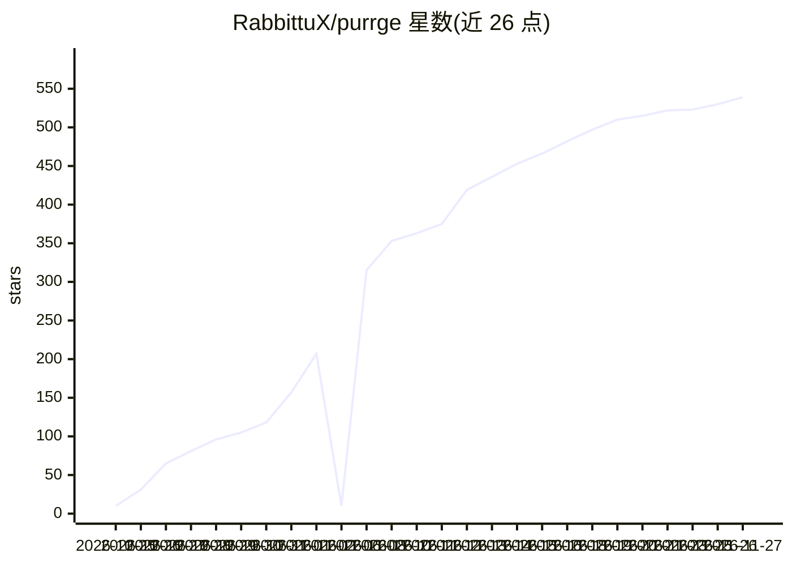

# RabbittuX/purrge

⭐ 539 · Python · NOASSERTION · 推送 2026-11-14 · [GitHub](https://github.com/RabbittuX/purrge) · [官网](https://static.yellowrabbit.online/purrge/index.html) · 个人维护 · 中文 README

**macOS/Windows 的 AI 磁盘清理工具：低空间提醒，AI 逐项评估后用户确认才清理**

Purrge 是一款磁盘空间管理工具，分 Mac 应用、Windows 应用与命令行版三个版本，核心功能一致：后台服务定时检测剩余空间，低于阈值时提醒；扫描后调用本机的 Claude Code、Codex、WorkBuddy 或 DeepSeek Harness 对缓存、安装包、大文件等逐项分析用途与清理影响；结果分三类呈现，仅执行用户勾选确认的项目，AI 在禁用工具/只读沙箱模式下运行、无删除权限。AI 不可用时回退为规则判断。命令行版源码在本仓库，采用 PolyForm Noncommercial 许可，桌面应用未开源、仅官网发布。

## 筛选速览

| 维度 | 判定 | 备注 |
|---|---|---|
| AI 角色 | `ai-enhanced` | 去掉 AI 部分产品仍成立 |
| 许可风险 | `none` | NOASSERTION |
| 部署形态 | `desktop` | 安装包/桌面程序 |
| 模型依赖 | locked-api |  |
| 硬件要求 | — | 无带数字的原话,不猜 |
| 安装摩擦 | `low` | 无编译、无系统依赖或容器化 |
| 成熟度 | — | 结构信号不足 |

## 能力要点

- 后台定时检测低空间并提醒，检测不消耗 AI 额度
- 调用本机 Claude Code/Codex/WorkBuddy/DeepSeek 逐项分析可清理项
- 用户勾选确认后才清理，AI 无删除权限、保护名单优先
- AI 不可用时自动切换为规则判断，基础功能不受影响

## 适用场景

- 磁盘空间不足时让 AI 帮我逐项判断哪些缓存和文件能清
- 不想手动翻找大文件，让工具定时监控并在空间吃紧时提醒
- 希望清理前逐项看到用途说明并自己确认，而不是自动删除

## 场景标签

 · 领域:系统工具/磁盘管理

## 证据(README 行号)

> L5: **基于 AI 的磁盘空间管理工具（macOS / Windows）：低空间预警、智能识别可清理项、经用户审批后执行清理。**
> L256: - Claude Code、Codex、WorkBuddy 或 DeepSeek Harness 任一可用账号（AI 分析使用用户自己的额度，支持 Codex 免费账号；DeepSeek 使用自己的 API Key）。AI 暂时
> L310: - **AI 仅提供分析，不具备删除权限**：Claude Code、WorkBuddy、DeepSeek Harness 在禁用全部工具的模式下运行，Codex 在只读沙箱中运行；删除操作由脚本严格依据用户勾选的清单执行。

## 星数曲线

2026-10-25 10 → 2026-11-27 539（+529）

---
*卡片 v1 · prompt 1.4 · 生成 2026-11-25 · 置信度 high · 依据 README sha `9f340da7c720` · [字段定义](../../DATASET.md)*
